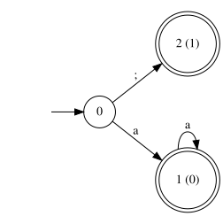
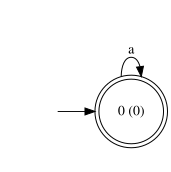
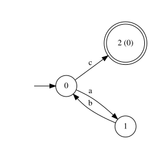

# Certified Split Points for Parallel Lexing: Exact and Modulo Discarded Tokens

**Nicklas Nidhögg**, August 4, 2026. Mirrors `paper/split-points/split-points.tex` as it now stands, revised beyond the
arXiv v3 source of [arXiv:2608.03473](https://arxiv.org/abs/2608.03473). The paper describes munch at the v1.2.0
release, with one later rule beside it. It makes three version statements of its own. It cites the library at release
tag `v1.2.0`, archived at doi:10.5281/zenodo.21752997. It names release 2.2.0 as the release that ships the coalesced
test of Section 5.1, the rule behind `Lexer::is_split_point_ignoring()`. And its applicability section notes that the
pinned v1.2.0 probe carries the construction-cost grammar's transcription "verified by eye only", a binding later
releases add mechanically. The exact decision of Section 5.2 is a figure program beside the library,
`paper/figures/modulo.hpp`, not part of it. The scaling measurements in the evaluation were taken on an earlier tree,
preserved by the `benchmark/split-points-2026-08` tag; the composition and validation figures are asserted from the
release tree under CI, and the certificate figures' DOT sources are regenerated there and byte-compared against the
committed copies. The tables below are produced mechanically from the paper's own tabular sources, never transcribed by
hand.

*A technical report on the mechanism behind `Lexer::is_split_point()`, `is_split_point_ignoring()`,
`chunk_boundaries()`, and `tokenize_all_parallel()`. The implementation, tests, and benchmarks live in this repository;
this document states the idea precisely, relates it to prior work, and reports where it applies.*

## Abstract

Table-driven DFA lexing is sequential, since each transition depends on the previous byte's state. Scanning one input in
parallel needs each chunk's entry state, which existing methods recover by simulation, speculation, prescanning, or
overlap. We give two conditions under which none is needed. For a longest-match scanner restarting from `q0` at every
token boundary, a byte `b` is a *certified split symbol* when no reachable state other than `q0` has a `b`-transition
whose target can reach acceptance, and `q0` is not re-entrant if it has one. Every occurrence of such a byte in
completely tokenizable input begins a token, so chunks starting there reproduce the serial sequence of kinds and
lengths. The condition is necessary and sufficient, but one string, comment, or whitespace run can remove every useful
certificate. Comments and whitespace are usually discarded, so we weaken the guarantee to equality after deleting a
declared discarded set and give a second condition, a precomputed constant-time one-bit test. It is *sound but
incomplete* and more permissive, strictly so on suitable token sets and discarded sets. It recovers newline for a
conventional C-like tokenization and tab, newline and carriage return for JSON, and refuses newline where block comments
are unrestricted. Safety modulo the discarded set is decidable in PSPACE for every token automaton and in polynomial
time for literal vocabularies, and every unsafe byte has a replayable counterexample. On the fifteen token sets studied
the second condition is already exact. Splitting at exact certificates in munch (release v1.2.0) reaches 92.6 to 95.3%
parallel efficiency at eight threads on a restricted CPU set and a 512 MiB corpus, and a 3.46 to 3.94× end-to-end
speedup at four threads, on one machine. It turns delimiter-based parallel lexing from a language-specific assumption
into a property a compiler checks.

## 1 Introduction

A table-compiled scanner performs, for each byte examined during a token match, a transition of the form
`state = table[row(byte) + state]`. Within one match the transition-table load is loop-carried, its address depending on
the state the previous load returned, so throughput is bounded by the load-to-use latency of the cache holding the
table. Token boundaries reset the state to `q0`, which can expose independent short matches to out-of-order execution,
but the recurrence still limits long table walks. This work exposes additional independent chains by scanning several
regions of one input concurrently.

Splitting is the obstacle. A scanner dropped at an arbitrary offset does not know the automaton state there. The offset
may fall inside a string literal, halfway through an identifier, or in the middle of a multi-byte operator. Starting
from an incorrect entry state can change the emitted stream until the runs converge, and whether and when they converge
depends on the automaton and the input.

Practice has an answer already: cut at a newline and rescan a little on each side of the cut until the two scans agree.
It bets that a newline begins a token and pays for the bet with the rescan. Where it matters the bet loses, and the
repair has no bound. Inside a block comment or a string that may span lines a newline begins nothing, so a chunk entered
there scans the rest of the comment or string as if it were code. The rescan meant to repair this may have to run back
to the token's opener or forward to its terminator, neither distance bounded by anything in the token set. The
certificate is the exact form of the same idea with the bet removed. Instead of assuming which bytes begin tokens, it
asks the compiled automaton once, at construction, and tests the answer in one bit per byte. Where cutting at newline
was sound all along, the answer is newline; where it was not, the answer is a refusal, with no rescan to repair the cut.
Section 7 shows that the usual C-like token set with block comments is refused, and what it would cost to change that.

This paper describes a property that removes the uncertainty for a useful class of token sets. The property is a
per-symbol certificate, extracted from the compiled automaton at construction time, such that every occurrence of a
certified byte in every completely tokenizable input begins a token. For a completely tokenizable input, chunk
boundaries placed immediately before those occurrences need no speculation and no reconciliation, because ordered
concatenation of the chunk streams equals the serial stream.

The contributions are:

- A static condition on a compiled token automaton identifying the bytes at which a longest-match scanner is provably
  between tokens, including the re-entrancy requirement without which the natural criterion is unsound (Section 4).
- A proof that the condition is necessary as well as sufficient once the analysis is restricted to states that an input
  can reach and from which acceptance is still reachable. Consequently, if no useful byte certifies, no byte occurring
  in a completely tokenizable input is universally safe before every occurrence (Section 4.1).
- An `O(|Q| |Σ|)` derivation over the logical compiled transition table, a boundary planner, and an exactness theorem
  for the resulting parallel scan, implemented and released in a general-purpose lexer library (Sections 6 and 8). The
  planner and executor decide boundaries with the exact condition, and the evaluation measures that path.
- A second condition, which weakens equality to hold only after the tokens in a caller's discarded set `I` are deleted
  and is *sound*, and *conservative* in that it may refuse a byte at which every cut is safe. Every exact certificate
  remains certified modulo `I`, and the inclusion is strict for some token sets and discarded sets. The condition is
  precomputed from the same tables as a constant-time one-bit test, and it recovers newline for the conventional C-like
  and JSON tokenizations that certify nothing exactly (Section 5). A stronger local test, the rule of release 2.2.0 of
  munch, is proved sound, strictly stronger and still incomplete. The library ships that test as a second constant-time
  one-bit query outside the planner, so a caller using it places the boundaries itself (Section 5.1).
- The exact question answered: safety modulo `I` at every occurrence is decidable in polynomial space for every token
  automaton and in polynomial time for literal vocabularies, and every unsafe byte comes with an input and a cut that
  replay the failure. The decision runs a complete-scan automaton with obligation sets, a failure automaton beside it,
  and a finite test of output equality by group delays (Section 5.2).
- A controlled applicability study of fifteen token sets under both conditions, showing where each condition yields
  useful bytes, how one added token kind can eliminate every useful exact certificate, and when line-based splitting is
  sound for the C-like tokenizations studied. The exact decision confirms every cell of the relaxed column (Section 7).

**Table 1.** What this paper establishes. Every row is stated and proved or measured at the location named. The
applicability results are asserted cell by cell by `figures/applicability.cpp`, and the throughput row rests on one
machine and two benchmark revisions, as Section 8 details.

| Question                                                             | Answer                                                                                                                                                                                                         | Where              |
|----------------------------------------------------------------------|----------------------------------------------------------------------------------------------------------------------------------------------------------------------------------------------------------------|--------------------|
| When may a chunk boundary be taken without knowing what precedes it? | No live state other than `q0` has a live transition on the byte, and `q0` is not re-entrant if it has one                                                                                                      | Theorem 1          |
| Is that condition merely sufficient?                                 | No, it is necessary as well                                                                                                                                                                                    | Theorem 2          |
| What does it cost to decide?                                         | Time linear in the compiled tables, then one bit per byte                                                                                                                                                      | Section 6          |
| Do real token sets satisfy it?                                       | 15 token sets measured, and the conventional C-like and JSON rows certify no useful byte exactly                                                                                                               | Table 2            |
| Can a token set that certifies no useful byte be rescued?            | Weakening to equality modulo discarded tokens recovers newline there, and eight of the fifteen rows gain bytes                                                                                                 | Section 5, Table 2 |
| Is a refusal of the relaxed condition final?                         | No. Safety modulo `I` is decidable in polynomial space and every unsafe byte has a replayable counterexample. On the fifteen rows every refusal stood                                                          | Theorem 5, Table 2 |
| Can it be bought by design?                                          | In the studied grammar the block comment is the one token spanning lines. Once newline is its own token, a line-bounded block comment suffices, while barring the kinds from each other's openers buys nothing | Table 2            |
| Does it pay?                                                         | 92.6 to 95.3% parallel efficiency at eight threads, 3.46 to 3.94× end to end at four                                                                                                                           | Section 8          |

Table 1 gathers the claim in one place before the definitions arrive. The paper separates the result from the study
around it. The result is Sections 3 to 5: the definitions, the exact certificate with its necessity proof and the
re-entrancy subtlety, the relaxed condition modulo discarded tokens, the stronger coalesced test of Section 5.1, and the
exact decision of Section 5.2. The study and the artifact are Sections 6 to 8: the derivation and planner, the
applicability of both conditions over fifteen token sets, and the measured parallel scan. Section 2 places the
certificate among the existing answers to the entry-state problem before the result, and Section 10 returns to that
literature after it. A companion paper generalizes the certificate from single bytes to short byte windows
([arXiv:2608.09761](https://arxiv.org/abs/2608.09761)), and a second reuses the same certificates to choose where a scan
resumes after an error ([arXiv:2609.10600](https://arxiv.org/abs/2609.10600)); nothing here depends on either.

## 2 Prior approaches

Published solutions mostly accept the unknown-state problem and manage it. The few that avoid it assume or prove a
delimiter for one format, as the paragraph on delimiters below records.

**Compile the simulation into the automaton.** In simultaneous finite automata (Sin'ya, Matsuzaki and Sassa, ICPP 2013)
each state of the extended automaton is a mapping from entry state to exit state, so one ordinary pass over a chunk
yields that chunk's whole transfer function. The mappings compose associatively, and chunks combine in a parallel
reduction. The per-state simulation moves from scan time to construction, and the authors report almost no runtime
overhead. The cost is the size of the constructed automaton, whose states are maps on states, so the worst case is `nⁿ`
from a DFA with `n` states and `2^(n²)` from an NFA, though for the expressions they survey it is usually far smaller.
Of the more than 20,000 SNORT expressions they measure, 98.6% give a D-SFA no larger than the square of the minimal DFA,
279 exceed it and six exceed its cube. The reduction step also remains.

Composition can also be applied directly instead of compiled in, and in that form it is a classical answer. Hillis and
Steele (Communications of the ACM 1986) treat each character as a unary function on states, observe that the induced
composition is associative, and recover the state after every character with one parallel-prefix operation. Their worked
example is lexing program text, and Yang (Computer Languages 1996) shows that the example needs care. The scan requires
an automaton that can tell a token has begun as soon as its first character is read; that holds for one-character
lookahead but not in general, so an automaton needing more must be transformed before the scan applies at all. A Mealy
machine attaches token output to transitions instead of states, and that makes the lookahead behavior representable. The
object composed for maximal-munch lexing is richer than a map from states to states. Data-parallel finite-state machines
(Mytkowicz, Musuvathi and Schulte, ASPLOS 2014) take the same route on SIMD and multicore hardware, enumerating
transitions from every possible start state so that the enumeration is exactly the transition function, and citing
Hillis and Steele as the basis for doing so. The resulting transfer function is exact, and once the chunk summaries
determine the correct entry states the chunks are run again to produce output, so nothing is guessed and nothing needs
repair. The cost is a factor of `|Q|` in work, which convergence reduces in practice, though the authors report that
convergence to a single state is rare. A GPU lexer applies the same scan to recover the complete state stream, the state
after every input position (Voetter, Leiden University MSc thesis 2021). Holding one function table per input position
costs `O(|Q|n)` space, so that work precomputes the reachable compositions and identifies each by an integer, reducing
composition to a two-dimensional lookup. The trade is the one the simultaneous construction makes in states, here paid
in a table.

**Carry fewer entry states.** Composition is exact but pays for every state. A second family attacks that cost by
shrinking the set a chunk must carry. One line of work uses single-state speculation. Jones et al. (HotPar 2009) observe
that in lexing the automaton reaches a stable state within a few characters, so prepending a short suffix of its left
neighbor to each chunk usually recovers the entry state. Prabhu et al. (PLDI 2010) make the pattern explicit as language
constructs for prediction, validation on completion and re-execution on a miss, with lexical analysis as the motivating
workload and the entry state predicted by scanning a few characters before the cut. Luchaup et al. (RAID 2009) place the
same wager for intrusion-detection signature matching, where a secondary scan enters its chunk in the DFA's start state
and records its state after every character, and the primary validates by running on into the chunk and comparing
against that history until the two couple, so even a wrong guess usually costs only the short prefix before convergence.
Enumerative speculation sits between the extremes of guessing one state and enumerating all of them, speculating
transitions from several states chosen by a lookback over the preceding input (Jiang and Agrawal, PPoPP 2017).
Reduced-interface DFAs (Borsotti, Breveglieri, Morzenti and Crespi Reghizzi, PPoPP 2025) attack the same overhead from
the automaton side, cutting the number of starting states a chunk automaton must carry by combining an NFA's state
reduction with deterministic transitions. The remaining costs differ. A lookback speculation can miss, and a miss costs
a rescan, whereas a reduced-interface DFA carries its interface in full and pays instead in proportion to that
interface's size. Both approaches may still carry more than one candidate entry state, and that extra work is one limit
on the speedup.

**Relocate cuts to a language's separators.** Parallel lexers have long been built by cutting near equal divisions and
sliding each cut to a language-specific separator (Barenghi, Crespi Reghizzi, Mandrioli, Panella and Pradella, Science
of Computer Programming 2015). The separator and the search bound are chosen by hand, and finding a separator does not
by itself remove the entry-state problem. The accompanying parallel lexical analysis still enumerates the possible start
states of a chunk. Each worker carries one computation per alternative, at most three in their worked cases and four in
the stated worst case, when the bounded separator search finds none. The technique is therefore separator relocation
combined with state enumeration, not a proof that the separator is safe. Its worked cases are the direct antecedent of
Section 7. Newline preserves the JSON token stream that survives discarding, since no surviving lexeme admits it, yet it
is rejected in practice because generated JSON may contain no newline (Li, Sato, Liu and Taura, IPDPS 2021). Lua fails
for a stronger reason than any certificate could address: its long-bracket delimiters `[=ⁿ[` and `]=ⁿ]` must agree on
`n`, so the lexical grammar is not regular, the set of possible delimiters is unbounded, and with it the set of possible
entry states. No fixed lookahead can decide which delimiter, if any, encloses a chunk. Barenghi et al. recover a
workable schema only by constraining the language, admitting just `[[` and `]]` for strings and requiring the multiline
comment's closing delimiter to occur at line end, after which newline does serve as their split point. The missing piece
is a way to decide, from the token set alone, whether every relevant occurrence of a proposed byte is safe to cut
immediately before.

**Prescan for context.** Plex (Li, Sato, Liu and Taura, IPDPS 2021) removes the need for delimiters entirely. From the
scanner's own DFA it derives a backtrack-free prescanning automaton, runs a prescan to recover each chunk's context, and
then scans the chunks in parallel without language-specific delimiter analysis. The price is a pass over the input; the
benefit is that it applies to grammars that certify nothing here.

**Analyze the grammar for streaming.** Deciding something about a maximal-munch token set statically, before any input,
is an established move. Yang, Tsay, and Chan (Computer Languages, Systems & Structures 2002) decide automatically
whether the longest-match rule is applicable at all for a given token set and parser grammar, and identify precisely the
situations in which it is not; the question is different from ours, but the setting is the same. StreamTok (Li, Yang and
Mamouras, ASPLOS 2026) is methodologically nearer still, since it too analyzes such a grammar statically and partitions
grammars into those its technique serves and those it does not. Its maximum token neighbor distance bounds how far a
longest-match decision can depend on future input, and that bound makes bounded-memory streaming possible. StreamTok
derives no input-independent split symbols or certified chunk boundaries, and parallelizing it is left as future work
there. The two analyses are complementary, since StreamTok bounds the context needed to confirm a token while the
certificate identifies positions where no preceding context is needed at all.

**Recover a restart point after an edit.** Incremental lexers face the mirror of this question (Wagner and Graham, UC
Berkeley manuscript 1997): after an edit, how far back must re-lexing begin for the result to equal a full re-scan? They
answer it dynamically and per edit, saving the batch machine's state with each token as it is created so analysis can
restart at any token boundary, and tracking lookahead dependencies as they arise, with no bound set in advance. The
certificate answers a static question instead, once per token set and before any input exists, and the two are
complementary because a restart point is a fact about one input and its history while a certified byte is a fact about
the grammar. An incremental divide-and-conquer lexer (Hugo and Hansson, Chalmers MSc thesis 2015) takes the other route
open to it, storing a result for every possible entry state of a fragment and composing the resulting transition maps,
which places it in the all-state family.

**Restrict the automaton.** Holub and Štekr's parallel run (CIAA 2009) is exact and efficient for `k`-local automata, in
which any `k` consecutive symbols force a unique state regardless of the starting state. The property is uniform over
the whole automaton, and a lexical grammar need not have it.

**Realign after the fact.** Parallel tokenization for language-model vocabularies faces the same boundary problem. The
overlap-based answer to it extends chunks so neighbors share a region and merges inside it, but it does not guarantee
the sequential result. LoPT (Shao et al., ACL 2026) remains overlap-based, matches overlap tokens by character position,
and retries with a doubled chunk whenever no overlap token matches. For WordPiece and BPE, its Theorem 3.1 is
conditional on a sufficient overlap condition: equality with sequential tokenization holds when every position-aligned
overlap spans more characters than the longest vocabulary token. TokTier (Zhang and Cao, arXiv 2026) reports that LoPT's
published experimental configuration "does not satisfy its safety theorem's stated precondition" and that TokTier's
clean-room reproduction "found inputs on which the length threshold stated in its paper admits a boundary outside the
premise of its theorem". We cite both findings as theirs. Not all of that work is overlap-based. Gigatoken certifies
cuts before selected punctuation in SentencePiece input where no vocabulary piece contains the two symbols at the cut in
that order. It argues in a source comment that a merge's result is always a vocabulary piece, so that no merge can span
such a boundary (Rød, Gigatoken, 2026). The runtime of SentencePiece Lite states the same principle for its vocabularies
(SentencePiece Lite Runtime, 2026), and Xu checks a merge table for cuts across which no merge joins (Xu, blog post
2026). Each is a sufficient condition read off one tokenizer family's vocabulary before any input, the subword
counterpart of the certified split windows ([arXiv:2608.09761](https://arxiv.org/abs/2608.09761)) rather than of a
certified byte.

**Assume a delimiter.** Data systems split logs and CSV at newlines because "records do not contain newlines", adjusting
each cut to the next delimiter. The assumption is per-format and usually informal, and it is famously unsound for CSV,
where RFC 4180 explicitly permits CRLF inside double-quoted fields (Shafranovich, RFC 4180 2005), which is why
speculative CSV parsing is a research topic (Ge, Li, Eilebrecht, Chandramouli and Kossmann, SIGMOD 2019). Where it has
been replaced by a proof, the proof is about one format. Ge et al. show that a quote followed by an ordinary character,
and an ordinary character followed by a quote, each rule out some starting states of their CSV automaton and leave every
surviving run in a single state, so a chunk containing either pattern is unambiguous (Ge et al., SIGMOD 2019, Section
4.4 and Appendix A, Property 2). Massively parallel delimiter parsing (Stehle and Jacobsen, PVLDB 2020) attacks the same
context problem on GPUs. Parallel lexical analysis has also been built by choosing cut positions directly, and Barve and
Joshi (International Journal of Computer Applications 2014) take newline, whitespace and selected language constructs as
pivot elements. Those pivots are chosen for the language by hand, and deriving them from its token set is the step the
certificate supplies. Format-specific structural scans hand-derive comparable facts per format: Mison (Li,
Katsipoulakis, Chandramouli, Goldstein and Kossmann, PVLDB 2017) and simdjson (Langdale and Lemire, VLDB Journal 2019)
locate JSON's structural characters and mask away the occurrences inside strings, while Parabix (Cameron, Herdy and Lin,
CASCON 2008) builds XML lexical and validation bit streams, a different construction aimed at a different format.

Among the preceding methods surveyed here, none derives from a compiled token automaton the complete set of raw-input
bytes safe to cut immediately before at every occurrence in a completely tokenizable input. Lexer generators come
closest, and re2c analyzes the compiled automaton to reject rules in which one user-declared end-of-input sentinel may
occur before a lexeme ends (re2c documentation, 2026). The check is a terminal-in-lexeme test for a declared byte, a
safe-after property under the model used here, and derives no safe-before set. Section 10 shows that the two properties
are incomparable.

## 3 Preliminaries

Let `Σ` be the byte alphabet. We take a compiled token set to be a deterministic automaton `A = (Q, Σ, δ, q0, τ)` with a
partial transition function `δ : Q × Σ ⇀ Q`, an initial state `q0 ∈ Q`, and a partial accepting map `τ : Q ⇀ T`
assigning a token to accepting states. Both `Q` and `T` are finite, `Σ = {0, ..., 255}`, and the single-valued `τ`
already contains the winner of any same-length priority tie resolved during compilation, lower priority number first and
lower token ID second. We write `δ*(q, u)` for the state reached from `q` on `u ∈ Σ*` when every transition along the
way is defined, and say `δ*(q, u)` is undefined otherwise.

The scanner is the usual longest-match loop. At offset `i` of an input `w ∈ Σ*` it starts in `q0`, consumes bytes while
transitions are defined, remembers the last position at which `τ` was defined, emits the token found there, and restarts
at that position in `q0`. If no accepting position is reached, the scan halts at `i`. Tokens are positive-length: an
accepting position is eligible only after at least one symbol has been consumed, so an accepting `q0` never emits the
empty word. If no positive-length accepting prefix exists the scan halts; emitting a length-zero match there would
restart at the same offset forever, and Section 4.2 needs that ruled out. The whole-input entry point and each
chunk-local scan used by the parallel entry point treat a final length-zero match as failure and halt at that offset,
and one failed chunk stops no other. The single-match entry point reports the length-zero match instead, and a caller
looping over it must reject that match itself. The composite system is not a single automaton run but a run that *resets
to `q0` at every token boundary*, and the certificate exploits that reset. Write `tok(w)` for the sequence of (token,
length) pairs the scanner emits on `w`, and `con(w)` for the scanner's final committed offset, equivalently the sum of
the lengths in `tok(w)`; bytes inspected during failed lookahead beyond the last accepted prefix are not counted. Call
`w` *completely tokenizable* when `con(w) = |w|`, and call an offset a *token boundary* of `w` when it is `0` or a
cumulative sum of the emitted lengths; `con(w)` is always a boundary, and `|w|` is one exactly when `w` is completely
tokenizable.

## 4 The certificate

A state can lie on an emitted token only if some input reaches it and some continuation from it still accepts, and the
certificate is defined over those alone. Write
`Q⁺ = { q ∈ Q | δ*(q0, u) = q for some u ∈ Σ*, and δ*(q, v) is accepting for some v ∈ Σ* }` for the states that are both
reachable and co-accessible, and let `δ⁺(q, a) = δ(q, a)` when that transition is defined and `δ(q, a) ∈ Q⁺`, and be
undefined otherwise. All that follows is stated over the *live subautomaton* `A⁺ = (Q⁺, Σ, δ⁺, q0, τ)`. Section 4.1
shows why neither half of the restriction is cosmetic. A pattern denoting the empty language leaves reachable states
outside `Q⁺` whose transitions would otherwise de-certify symbols that no token can contain. A state no input enters
lies on no counterexample, so admitting one would let a transition that no scan ever takes de-certify a symbol that
every scan treats as safe. If `q0 ∉ Q⁺` the token set accepts nothing, and no symbol is useful; we assume `q0 ∈ Q⁺`
throughout.

One consequence is used repeatedly below: the match path of any emitted token lies in `A⁺` throughout, since every
transition along it leads to that token's accepting position, so reasoning about emitted tokens may read `δ` as `δ⁺`
without further comment. A second consequence is of the same kind: every `q ∈ Q⁺` is reachable by a path lying in `A⁺`
throughout, since an intermediate state of a `δ`-path from `q0` to `q` is reachable by the path's prefix and
co-accessible by appending the path's remainder and then an accepting continuation from `q`. Wherever reachability of a
state in `Q⁺` is invoked below, `(δ⁺)*(q0, u) = q` may be read directly.

**Definition 1 (re-entrant initial state).** `q0` is *re-entrant* if `(δ⁺)*(q0, u) = q0` for some `u ∈ Σ⁺`.

Because every state of `Q⁺` is reachable, Definition 1 is equivalent to `q0` having an incoming live transition from a
state of `Q⁺`, which is how an implementation tests it.

**Definition 2 (certified split symbol).** A symbol `b ∈ Σ` is *certified* if every `q ∈ Q⁺` with `δ⁺(q, b)` defined
satisfies `q = q0`, and if `δ⁺(q0, b)` is defined then `q0` is not re-entrant.

The exemption for `q0` makes useful certificates possible, since a token may legitimately begin with `b`. The exemption
is sound only while no input can return the automaton to `q0` mid-scan, which is precisely the re-entrancy condition.
Section 4.2 shows that dropping it makes the certificate false.

The definition has an instance every reader has met. Take the token set whose tokens are the encoding forms of UTF-8
(Yergeau, RFC 3629 2003), one token per form. After a byte that begins a form only continuation bytes, `0x80` to `0xBF`,
are admitted until the form completes, and no form is a prefix of another, so no live state other than `q0` has a
transition on a byte that begins a form and no transition returns to `q0`. Every such byte, `0x00` to `0x7F`, `0xC2` to
`0xDF`, `0xE0` to `0xEF` and `0xF0` to `0xF4`, is certified, and no continuation byte is, since only states other than
`q0` consume one. The bytes no form contains, `0xC0`, `0xC1` and `0xF5` to `0xFF`, are certified vacuously, and the
shipped predicate withholds them as Corollary 2 says. That is the property the RFC lists among the encoding's
characteristics, "character boundaries are easily found from anywhere in an octet stream", and a definition that knows
nothing of UTF-8 recovers it from the compiled table. `figures/applicability.cpp` asserts it byte for byte. The question
this paper asks is which token sets have that property, and Section 7 answers for fifteen of them.

**Lemma 1 (occurrences begin tokens).** Let `b` be certified and let `w` be completely tokenizable. Then every offset of
`w` holding `b` is a token boundary of `w`.

*Proof.* Let `w_i = b` and suppose `i` is not a token boundary. Since `w` is completely tokenizable, every offset is
either a token boundary or lies strictly inside some emitted token, so `i` lies strictly inside a token that starts at
some `s < i`. Let `u = w_s ... w_(i-1)`, which is nonempty, and let `q = (δ⁺)*(q0, u)`, the state immediately before `b`
is consumed. The token's match path continues through offset `i`, so `δ⁺(q, b)` is defined. By Definition 2, `q = q0`,
hence `(δ⁺)*(q0, u) = q0` with `u` nonempty, so `q0` is re-entrant by Definition 1. But `δ⁺(q0, b) = δ⁺(q, b)` is
defined, so Definition 2 also requires `q0` not to be re-entrant, a contradiction. ∎

**Lemma 2 (prefix stability).** Let `w` be completely tokenizable, let `s` be a token boundary of `w`, and let `v` be
any prefix of `w` with `|v| >= s`. Then `v` and `w` emit the same tokens on `[0, s)`, and the scan of `v` reaches `s` in
state `q0`.

*Proof.* If `s = 0` both claims are immediate, since `[0, s)` is empty and the scan of `v` starts at offset `0` in `q0`.
Assume `s > 0`. First, no token of `w` beginning at some `s' < s` records an accepting position after `s`, since longest
match takes the last accepting position reached, so such a token would span past `s`, placing `s` strictly inside it and
contradicting that `s` is a boundary.

The rest is an induction over the tokens preceding `s`. Suppose both scans begin a token at the same offset `s' < s` in
`q0`, which holds at offset `0`. From `s'` the two scans read the same bytes, since `v` agrees with `w` byte for byte as
far as it goes. They traverse the same states while both inputs last, and the accepting positions they record at offsets
up to `|v|` coincide. By the bound above, every accepting position this token records in `w` lies at or before
`s <= |v|`, so both scans record the same set of accepting positions, take the same last member of it, and emit the same
kind and length. Truncation removed only lookahead that failed. Both then restart in `q0` at the same next offset, which
is at most `s`. The restart offsets increase strictly, and `s` is a boundary of `w`, so the induction reaches offset `s`
exactly. Every token before `s` is emitted identically in both scans, and the scan of `v` reaches `s` in `q0`. ∎

**Theorem 1 (split invariance).** Let `w` be completely tokenizable and let `0 = c_0 < c_1 < ... < c_m = |w|` be offsets
such that each interior `c_j` holds a certified symbol. Then
`tok(w) = tok(w[c_0..c_1)) · tok(w[c_1..c_2)) ··· tok(w[c_(m-1)..c_m))`, where `·` denotes concatenation of token
sequences and `w[a..b)` the corresponding slice.

*Proof.* The offsets are strictly increasing, so every chunk has positive length, which the argument uses where it takes
a nonempty prefix before an interior boundary. A driver must supply distinct offsets for the theorem to apply at all.
For empty `w` the partition degenerates to the single offset `0`, both sides are the empty sequence, and the claim is
trivial; assume `|w| > 0`. By Lemma 1 every interior `c_j` is a token boundary of `w`, and `c_0` and `c_m` are
boundaries trivially. Two facts are then needed. First, the scanner is deterministic and enters each token in state `q0`
with no state carried across boundaries, so a scan started at `c_j` begins as the global scan does there. Second, while
matching the last token of the chunk the global scan records no accepting position beyond `c_(j+1)`. Let `q` be the
state reached on the nonempty prefix ending just before `c_(j+1)`. If `δ⁺(q, b)` were defined for the certified `b` at
`c_(j+1)`, the argument of Lemma 1 would force `q = q0` and make `q0` re-entrant, which Definition 2 forbids, so
`δ⁺(q, b)` is not defined. Either `δ(q, b)` is undefined, and the scan stops at `c_(j+1)`, or its target lies outside
`Q⁺`, since otherwise `q` would itself be co-accessible and `δ⁺(q, b)` would be defined. In the second case the scan may
read on but cannot reach an accepting state again. Note that the scan is not required to *stop* at `c_(j+1)`, only to
find nothing past it. Lookahead may cross the boundary through transitions that lead nowhere. Either way the last
accepting position it recorded lies at or before `c_(j+1)`, and the chunk scan, seeing the same bytes from the same
state, records the same one, so the tokens emitted between `c_j` and `c_(j+1)` coincide. The second fact is needed only
for interior boundaries. When `j + 1 = m` the right edge is the end of the input. It carries no symbol and the global
scan has no bytes left there either, so the final chunk sees the suffix the global scan sees, from the same state, and
the two agree without further argument. Induction over `j` gives the claim. ∎

**Lemma 3 (boundaries before the first failure).** Let `b` be certified and let `w` be any input. Every offset
`i < con(w)` with `w_i = b` is a token boundary of the serial scan of `w`.

*Proof.* Every offset below `con(w)` is either a token boundary or lies strictly inside a token the scan emitted, so if
`i` is not a boundary it lies strictly inside a token starting at some `s < i`. The argument of Lemma 1 applies
unchanged to that token. The state `q` reached on the nonempty `w_s ... w_(i-1)` has `δ⁺(q, b)` defined, hence `q = q0`
by Definition 2, hence `q0` is re-entrant, which Definition 2 forbids once `δ⁺(q0, b)` is defined. Completeness of the
tokenization is not used, only that the offsets below `con(w)` were successfully traversed. ∎

**Corollary 1 (malformed input).** Take the partition of Theorem 1. If `con(w) < |w|`, let `[c_j, c_(j+1))` be the chunk
containing the first failure, which is the chunk's own first byte when `con(w) = c_j`. By Lemma 3 every interior
boundary below `con(w)` is a token boundary of the serial scan, so the reasoning of Theorem 1 applies to the chunks
before it. Every chunk before `c_j` is fully consumed and contributes exactly the tokens the serial scan emits there,
and the chunk containing the failure halts at the same offset. The serial stream is therefore a prefix of the
concatenation, but chunks after the failure may emit tokens the serial scan never reaches. A caller must check every
chunk's consumed length before treating the concatenation as a successful tokenization.

**Proposition 1 (vacuous certificates).** If no `q ∈ Q⁺` has `δ⁺(q, b)` defined, then `b` is certified, and no
completely tokenizable input contains `b`.

*Proof.* The first claim holds because Definition 2 quantifies over an empty set. For the second, a completely
tokenizable `w` containing `b` would have `b` consumed by some emitted token, whose match path lies in `A⁺`, so some
state of `Q⁺` would consume `b` live. ∎

Such symbols are certified but useless for planning, since they cannot appear in valid input. Vacuous certificates can
also be identified mechanically, with no further analysis. If `b` is certified then every live state consuming it is
`q0`, so `b` is consumed live by some state exactly when `δ⁺(q0, b)` is defined:

**Corollary 2 (useful certificates).** A certified `b` is non-vacuous if and only if `δ⁺(q0, b)` is defined.

An implementation can therefore obtain the useful set with no extra analysis, by intersecting the certificate with the
initial state's live transitions, and the predicate in the accompanying library reports that set. Useful certificates
are the *occurring* ones in the terminology of the companion paper on certified splitting
([arXiv:2610.08854](https://arxiv.org/abs/2610.08854)), called the splitting companion below. A useful `b` occurs in a
completely tokenizable input `bv` that scans as one token, by the argument in the proof of Theorem 2, and by Proposition
1 no vacuous one occurs in any. Vacuous certificates never reach a caller, since a caller cannot act on one and a
planner searching for one scans the whole input for nothing.

### 4.1 The condition is also necessary

Definition 2 is stated as a test, and Lemma 1 shows it is sufficient. The test is also necessary, so nothing is given
away by using it. Necessity needs only the standing assumption that the token set accepts some word (`q0 ∈ Q⁺`), since
the states of `Q⁺` are reachable and co-accessible by construction, as the counterexample below requires. The theorem
therefore applies to every such token set whatever automaton it was compiled from, and a token set accepting nothing
certifies no useful symbol in the first place.

**Theorem 2 (characterization).** Assume the standing `q0 ∈ Q⁺`. Then `b` is certified if and only if every occurrence
of `b`, in every completely tokenizable input, begins a token.

*Proof.* Sufficiency is Lemma 1. For necessity we show that a rejected `b` admits a counterexample: a completely
tokenizable input in which an occurrence of `b` is not a token boundary. Definition 2 rejects `b` in exactly two ways.

Suppose some `q ≠ q0` has `δ⁺(q, b)` defined. Then `q ∈ Q⁺` is reachable, so `(δ⁺)*(q0, u) = q` for some `u`, and `u` is
nonempty because `q ≠ q0`. The target `δ⁺(q, b)` lies in `Q⁺` by the definition of `δ⁺`, so `(δ⁺)*(δ⁺(q, b), v)` is
accepting for some `v`. Take `w = ubv`. Reading `w` from `q0` traverses `u` to `q`, then `b`, then `v` to an accepting
state, so the scan from offset `0` reaches an accepting position at `|w|`, and no later one exists because the input
ends there. Longest match emits a single token spanning `w`, so `w` is completely tokenizable, and the occurrence of `b`
at offset `|u| >= 1` begins no token.

Otherwise `δ⁺(q0, b)` is defined and `q0` is re-entrant. Re-entrancy gives a nonempty `u` with `(δ⁺)*(q0, u) = q0`, and
co-accessibility of `δ⁺(q0, b)` gives `v` as before. The same `w = ubv` is completely tokenizable and places `b` at
offset `|u| >= 1` inside its only token. ∎

The proof depends on restricting to `A⁺`, and the restriction is not cosmetic. A pattern denoting the empty language
leaves reachable states behind from which no accepting state can be reached. Taking `T_1 = ab · ∅` alongside `T_2 = b`,
the compiled automaton has `q0 --a--> q2 --b--> q1` beside `q0 --b--> q3` accepting, and `q1, q2` are reachable but not
co-accessible. Had Definition 2 been stated over `δ` rather than `δ⁺`, it would reject `b`, because the noninitial `q2`
consumes it; yet every completely tokenizable input here is a sequence of `b` tokens in which every `b` begins one, so
no counterexample exists and necessity would fail. Over `δ⁺` the offending transition is invisible, since `q1 ∉ Q⁺`, and
`b` certifies as it should. Minimization does not remove such chains, because the minimizer used here treats a missing
transition as distinct from one into a state that cannot accept. A scanner needs that distinction, since the two differ
in how far a longest match reads before failing. This minimization is deliberately weaker than Myhill-Nerode minimality,
under which every state with an empty right language is equivalent.

Reachability is the mirror image, and it matters for automata not produced by subset construction. Give the same
`T_2 = b` a detached `q4 --b--> q5` with `q5` accepting. Now `q4` is co-accessible and consumes `b`, so a definition
quantifying over co-accessible states alone would reject `b`; yet no input reaches `q4`, every completely tokenizable
input is again a sequence of `b` tokens, and no counterexample exists. Requiring reachability and co-accessibility in
`Q⁺` keeps the definition exactly as permissive as the scans it describes.

The derivation computes `Q⁺` first, in two sweeps. One forward sweep from `q0` marks the reachable states, and one
reverse sweep marks those from which an accepting state remains reachable. The certificate sweep then skips every
unmarked source and every transition whose target is unmarked, since neither can lie on an emitted token and so neither
carries information about where tokens may begin. Because the derivation computes both marks, Theorem 2 applies to a
hand-built automaton as much as to a compiled one. Each sweep visits each table entry once and leaves the `O(|Q| |Σ|)`
bound of Section 6 unchanged.

Corollary 2 depends on the same restriction. In the example `δ(q0, a)` is defined but `δ⁺(q0, a)` is not, since the
target `q2` is not co-accessible. A test phrased over `δ` would classify `a` as a useful certificate, even though no
input this token set accepts contains an `a` at all. Phrased over `δ⁺`, the test reports `a` as vacuous, which the
caller needs to know.

Consequently, for a token set compiled this way, "no useful byte certifies" is not a failure of the test but means that
no single byte can serve as a split symbol at all under the semantics of Section 3. The applicability results of Section
7 inherit that strength, and the negative rows there are statements about the tokenizations themselves.

### 4.2 The subtlety

Dropping the re-entrancy condition from Definition 2 makes the result false. Consider the token set consisting of the
single nullable pattern `a*`. Minimization yields an automaton whose initial state is accepting and carries a self-loop
on `a`; the only state consuming `a` is `q0`, so the naive certificate admits `a`. Splitting the input `aa` between its
two bytes then yields two tokens where the serial scan, by longest match, yields one. The condition is therefore
required for soundness.

Figure 1 shows why the condition is stated as an incoming transition rather than as a self-loop. In the nullable case
the initial state re-enters itself directly, which a self-loop test would catch. In the cyclic variant `(ab)*c` it
re-enters through the cycle `a, b`, and no self-loop exists anywhere; the only state consuming `c` is `q0`, so a
self-loop test would certify `c` and split `abc` in the middle of its only token. Both cases are carried as regression
tests.

**Figure 1.** Minimized automata drawn by the library described here. Double circles are accepting states, labeled with
the state number and the token identifier. In (a) nothing enters state 0 and no other state consumes `;`, so `;` is
certified. In (b) state 0 accepts and re-enters itself on `a`, and in (c) it is re-entered through the cycle `a, b`. In
both counterexamples the only state consuming the candidate byte is the initial one, so dropping the re-entrancy
condition would certify it and break longest match. The shipped predicate rejects the candidate in (b) and (c) and
accepts `;` in (a).

(a) `a+` and `;`:



(b) `a*`:



(c) `(ab)*c`:



## 5 Certification modulo discarded tokens

Fix a set `I ⊆ T` of *discarded* tokens, chosen by the caller. Write `π_I` for the map on token sequences deleting every
pair whose token lies in `I`, and call two sequences *`I`-equivalent* when `π_I` sends them to the same sequence.
Comparing streams modulo a designated token class is not new, since ZipLex's separator construction proves its printing
guarantee in this form, with re-lexing equal up to inserted separator tokens (Chassot and Kunčak, CAV 2026). The
question here is different, namely which symbols of raw input allow a cut that preserves `I`-equivalence. Such a cut can
land inside an existing discarded token, away from any seam between formed tokens.

Being discarded is not by itself sufficient. Cutting the line comment `//ab` between its last two bytes leaves `//a` on
the left, which is a comment and is discarded, and `b` on the right, which is an identifier and is not. The requirement
is that both halves of the severed token are discarded, and that the restarted scan rejoins the scan it interrupted.
Write `T(q) = { τ(p) | p = (δ⁺)*(q, v) for some v ∈ Σ*, τ(p) defined }` for the tokens still reachable from `q`, noting
`τ(q) ∈ T(q)` whenever `τ(q)` is defined.

**Definition 3 (certified modulo `I`).** A symbol `b ∈ Σ` is *certified modulo `I`* if every `q ∈ Q⁺` with `δ⁺(q, b)`
defined satisfies `A(q)` or `C(q)`, where `A(q) ≡ q = q0 and q0 is not re-entrant`, and `C(q)` holds when all three of

1. `τ(q)` is defined,
2. `δ⁺(q0, b)` is defined and equal to `δ⁺(q, b)`, and
3. `T(q) ⊆ I`

are satisfied.

The two alternatives are not symmetric, and the asymmetry matters. `A(q)` is Definition 2, under which the initial state
may consume `b` only while nothing returns to it mid-scan. `C(q)` is the relaxation, and it is available to *every*
consuming state including a re-entered `q0`. Requiring `A` of `q0` unconditionally would be strictly weaker than
necessary. For a discarded token `a*` the minimized automaton is one accepting, self-looping state, so `q0` is
re-entrant and `A` fails. Yet `C(q0)` holds, and cutting between two `a`s replaces one discarded token by two, which
`π_I` deletes either way.

Setting `I = ∅` recovers Definition 2 exactly, since `τ(q) ∈ T(q)` makes clause 3 unsatisfiable and only `A` survives.
Every certified symbol is certified modulo `I` for every `I`.

The three conditions of `C` do distinct work. Requiring `τ(q)` to be defined lets the left chunk stop at the cut with a
complete token. Requiring `T(q) ⊆ I` makes both that token and whatever the severed remainder becomes discardable, and
since `τ(q) ∈ T(q)` it also forces the left chunk's token to be discarded. The equality `δ⁺(q, b) = δ⁺(q0, b)` is the
load-bearing condition, since after consuming `b` the restarted scan occupies the same state as the scan it interrupted.
The two agree on every subsequent byte, and the disturbance is confined to the single token containing the cut. With the
equality the definition is a test on the transition table, and without it a statement about scanner equivalence. Section
5.1 weakens the equality to an equivalence that is still a test on the tables, and Section 5.2 decides the statement
itself. Where the two local tests must be told apart, Definition 3 is called the *state-equality condition*.

**Theorem 3 (split invariance modulo `I`).** Let `w` be completely tokenizable and let `0 = c_0 < c_1 < ... < c_m = |w|`
be offsets such that each interior `c_j` holds a symbol certified modulo `I`. Then
`π_I(tok(w)) = π_I(tok(w[c_0..c_1)) · tok(w[c_1..c_2)) ··· tok(w[c_(m-1)..c_m)))`, where `·` denotes concatenation of
token sequences and `w[a..b)` the corresponding slice.

*Proof.* For empty `w` the partition degenerates as in Theorem 1 and both images are empty; assume `|w| > 0`. By
induction on `m` it suffices to treat one interior cut at `c` holding `b`. The induction is well founded because the
one-cut argument below shows each chunk consumes its whole slice, so both slices are themselves completely tokenizable
and the remaining cuts may be applied to them in turn.

Suppose first that `c` is a token boundary of `w`. The left slice `w[0..c)` emits the same tokens as `w` on `[0, c)` by
Lemma 2 taken with `s = c`, and that rules out a last token whose failed lookahead crossed `c` in `w`. The scanner
enters every token in `q0` and carries no state across boundaries, so the chunk beginning at `c` starts in the same
state as the scan of `w` does there and reads the same bytes. The token sequences on the two sides are equal before
`π_I` is applied, and `π_I` preserves equality.

Otherwise `c` lies strictly inside an emitted token spanning `[s, e)` and carrying token `t`. Let `u = w_s ... w_(c-1)`,
which is nonempty, and let `q = (δ⁺)*(q0, u)` be the state immediately before `b` is consumed. The token's match path
continues through `c`, so `δ⁺(q, b)` is defined and `q` satisfies `A(q)` or `C(q)`. The state `q` cannot satisfy `A(q)`,
which would need `q = q0` with `q0` not re-entrant, yet `(δ⁺)*(q0, u) = q0` with `u` nonempty is precisely re-entrancy.
It follows that `C(q)` holds, and it holds whether or not `q` happens to be a re-entered `q0`; that is the only place
the generalization over Definition 2 is used.

Consider the chunk ending at `c`, which is the prefix `w[0..c)` with `c > s`. By Lemma 2 the chunk emits the same tokens
as `w` on `[0, s)` and reaches `s` in `q0`. The lemma rules out an earlier token whose failed lookahead ran past `s` in
`w` and is truncated here. The chunk then consumes `u` and arrives at `q` with the chunk exhausted. Since `τ(q)` is
defined by condition 1, the last accepting position recorded is `c` itself, so the chunk emits the single token `τ(q)`
spanning `[s, c)` and consumes to its end.

Consider the chunk beginning at `c`. The chunk starts in `q0` and consumes `b`, reaching `δ⁺(q0, b)`. By condition 2
this equals `δ⁺(q, b)`, the state the scan of `w` occupies after consuming the same byte at the same offset. From there
both runs read identical bytes from identical states, so they record identical accepting positions, and the chunk emits
`t` spanning `[c, e)`. Both runs then stand at `e` in `q0`, and `e` is a boundary of `w`, so the remainders agree. The
two sides differ only in that `t` on `[s, e)` is replaced by `τ(q)` on `[s, c)` followed by `t` on `[c, e)`. Both `τ(q)`
and `t` lie in `T(q)`, which condition 3 places inside `I`, so `π_I` deletes all three occurrences and the images
coincide. ∎

Corollary 1 has no analogue here. When the serial scan does not tokenize the input completely, no `π_I`-prefix relation
is claimed, and a caller must still check every chunk's consumed length before trusting the concatenation at all.

**Proposition 2 (useful certificates modulo `I`).** Proposition 1 and Corollary 2 carry over: a symbol no live state
consumes is certified modulo `I` for every `I` and occurs in no completely tokenizable input, and a symbol certified
modulo `I` is non-vacuous exactly when `δ⁺(q0, b)` is defined.

*Proof.* The first two claims are those of Proposition 1. Its argument does not depend on which of the two conditions
admitted `b`, since Definition 3 likewise quantifies over an empty set. For the third, every state consuming `b` live
satisfies `A` or `C`. Under `A` it is `q0`, and under `C` clause 2 gives `δ⁺(q, b) = δ⁺(q0, b)`, so either way some live
state consumes `b` exactly when `δ⁺(q0, b)` is defined. ∎

As in the exact setting, symbols that no live state consumes are certified but useless, since a caller cannot act on one
and a planner searching for one scans the whole input for nothing. Both the library predicate and every table below
report the *useful* set, intersecting the certificate with the initial state's live transitions. This matters for
reading Table 2. The definitions vacuously certify the raw control bytes that no token admits, and the table's JSON row
omits them and reports only the bytes an input can actually contain.

**Proposition 3 (strict extension).** Every certified symbol is certified modulo `I` for every `I ⊆ T`, and there are
token sets and sets `I` for which the converse fails.

*Proof.* The first claim is immediate, since Definition 3 offers `q = q0` as an alternative and its re-entrancy proviso
is that of Definition 2. For the second, take identifiers, punctuation and a whitespace run over space and newline, with
the whitespace token in `I`. Newline is not certified, since the state inside a whitespace run consumes it into a
co-accessible state. It is, however, certified modulo `I`, since that state accepts the whitespace token and reaches no
other token, and advancing on newline from it and from `q0` reaches the run state either way. ∎

### 5.1 A stronger local test

Definition 3 asks the restarted scan to stand in the very state of the scan it interrupted. The coalesced test, which
release 2.2.0 of munch ships, asks less, namely that the two states have the same future once discarded kinds are not
told apart. Complete `A⁺` with a sink `⊥`, reading an undefined `δ⁺(q, a)` as `⊥` and letting `δ⁺(⊥, a) = ⊥`. Give every
state an observation: *reject* when `τ` is undefined there, as at `⊥`, *discard* when `τ(q) ∈ I`, and `keep(τ(q))`
otherwise. Write `p ≡_I r` when for every `z ∈ Σ*` the states reached from `p` and from `r` on `z` carry the same
observation, which is Moore equivalence of the completed automaton with the discarded kinds coalesced into one color.
Discard stays distinct from reject, and the empty `z` compares the two states themselves.

**Definition 4 (certified modulo `I`, coalesced).** A symbol `b ∈ Σ` is *certified modulo `I` under the coalesced test*
if every `q ∈ Q⁺` with `δ⁺(q, b)` defined satisfies `A(q)` or `C'(q)`, where `A` is as in Definition 3 and `C'(q)` holds
when all three of

1. `τ(q) ∈ I`,
2. `δ⁺(q0, b)` is defined and `δ⁺(q0, b) ≡_I δ⁺(q, b)`, and
3. `T(δ⁺(q, b)) ⊆ I`

are satisfied.

Two things changed: equality of the two states became equivalence, and the requirement that the future be discarded
applies to the state past the cut rather than to the state before it. The old clause 3 asked that everything reachable
from `q` is discarded, but only the continuations through `b` belong to the severed token, and the new clause 1 discards
the left fragment itself.

**Theorem 4 (soundness of the coalesced test).** Theorem 3 holds with Definition 4 in place of Definition 3.

*Proof.* As in Theorem 3, one interior cut at `c` holding `b` suffices, and a cut at a token boundary of `w` is settled
as in that proof, without any use of `C`. Otherwise `c` lies strictly inside an emitted token spanning `[s, e)` and
carrying `t`. Let `u = w_s ... w_(c-1)` and `q = (δ⁺)*(q0, u)`. Then `δ⁺(q, b)` is defined, and `A(q)` fails as before,
so `C'(q)` holds.

The chunk ending at `c` emits the same tokens as `w` on `[0, s)` and reaches `s` in `q0`, by Lemma 2. It then consumes
`u` and arrives at `q` with the chunk exhausted. By clause 1, `τ(q)` is defined and lies in `I`, so the chunk emits
`τ(q)` spanning `[s, c)` and consumes to its end.

Write `p = δ⁺(q, b)` for the state the scan of `w` occupies after `c`, and `p0 = δ⁺(q0, b)` for the state the chunk
beginning at `c` occupies there. From `c + 1` on, both scans read the same bytes, and every accepting position a scan
records is reached by a path in `A⁺`, so for each `k >= 0` the two scans record position `c + 1 + k` exactly when the
states they reach from `p` and `p0` on the same `k` bytes accept. By clause 2 those two states carry the same
observation, so one accepts exactly when the other does. The scan of `w` records `e` last, so the chunk records `e` last
as well and emits a token spanning `[c, e)`. The kind the scan of `w` emits there is `t ∈ T(p)`, which clause 3 places
in `I`, so the state reached from `p` at `e` observes discard. The state reached from `p0` at `e` observes the same, so
the chunk's token is discarded too. Both scans restart in `q0` at `e`, which is a boundary of `w`, and the remainders
agree.

The two sides differ only in that `t` on `[s, e)` is replaced by `τ(q)` on `[s, c)` followed by a discarded token on
`[c, e)`. All three lie in `I`, so `π_I` deletes them and the images coincide. ∎

Nothing about lengths is given up, since both scans end the severed token at `e`. Compared with equality, the
equivalence gives up only the identity of the state at `e`, which the projection never sees.

**Proposition 4 (strictly stronger, and still incomplete).** Every symbol certified by Definition 3 is certified by
Definition 4. The converse fails, once for each of the two changes. And there are token sets and sets `I` with a symbol
safe modulo `I` at every occurrence that Definition 4 refuses.

*Proof.* For the inclusion, suppose `C(q)`. Then `τ(q) ∈ T(q) ⊆ I`, which is clause 1; equal states are equivalent,
which is clause 2; and `T(δ⁺(q, b)) ⊆ T(q) ⊆ I`, which is clause 3. `A` is unchanged.

For the first change, take the literals `a` and `ab` of one discarded kind `D`, the literal `b` of a second discarded
kind `E`, and a kept literal `k`. After `a` the scan stands in a state `q` accepting `D`. Advancing on `b` from `q`
reaches the state accepting `ab`, of kind `D`, and advancing from `q0` reaches the state accepting `b`, of kind `E`. The
two accept different kinds, so the minimizer keeps them apart and Definition 3 refuses `b`. Neither state has a live
transition, so once `D` and `E` share a color the two are equivalent. Clause 1 holds since `τ(q) = D`, and clause 3
since only `D` lies past the cut. The only other state consuming `b` is `q0`, which is not re-entrant, so Definition 4
admits `b`.

For the second change, take the literals `a`, `b`, `c` and `ab` of one discarded kind and the kept literal `ac`. After
`a` the scan stands in a state `q` from which `ac` is still reachable, so `T(q) ⊄ I` and Definition 3 refuses `b`. Yet
`δ⁺(q, b)` accepts `ab` and `δ⁺(q0, b)` accepts `b`. Both are discarded leaves and `τ(q)` is discarded, so Definition 4
admits `b`.

For incompleteness, take the literals `a`, `b`, `c` and `abc` of one discarded kind and the kept literals `k` and `kk`
of one kind `K`. Every input over these four letters tokenizes completely, since each letter is a token. Kept output
comes only from maximal runs of `k`, where a run of length `n` emits `(K, 2)` exactly `⌊n/2⌋` times and then `(K, 1)`
when `n` is odd, by longest match. A cut before a `b` lies inside no such run and leaves every run maximal in its chunk,
so both chunks tokenize completely and the kept streams concatenate to the whole input's kept stream. Hence every cut
before `b` is safe. Yet after `a`, advancing on `b` reaches the non-accepting prefix of `abc`, which observes reject,
while advancing from `q0` reaches the state accepting `b`, which observes discard. Clause 2 fails on the empty
continuation, so Definition 4 refuses `b`, and Definition 3 with it. ∎

The obstruction in the last example is structural. A safe cut may split one discarded token into several, with the
restarted scan rejoining the interrupted scan only after further restarts. Equivalence of the two states past the cut
forces the two scans to end their current tokens together, which in such a case they do not. For all three token sets
and the named example of Section 6.1, `validation.cpp` asserts the outcomes of both local tests, the decision of Section
5.2 and a bounded oracle.

### 5.2 The exact decision

Both local tests are sufficient conditions, and this section decides the property they approximate. Throughout, the
alphabet is restricted to the bytes some live state consumes, since no other byte occurs in a completely tokenizable
input, and `n = |Q⁺|`.

**Definition 5 (safe modulo `I`).** A symbol `b` is *safe modulo `I`* if for every completely tokenizable `w` and every
offset `0 < c < |w|` with `w_c = b`, both `w[0..c)` and `w[c..|w|)` are completely tokenizable and
`π_I(tok(w)) = π_I(tok(w[0..c))) · π_I(tok(w[c..|w|)))`.

The contract needs the chunk-completeness clause. Over the single discarded token `ab`, cutting `ab` before `b` leaves
two empty kept streams and two chunks neither of which tokenizes. The clause is also what makes one cut enough, since
applying Definition 5 to one interior cut leaves two completely tokenizable chunks. The remaining cuts apply to those in
turn, so the conclusion of Theorem 3 follows for any partition at safe symbols.

**Theorem 5 (exact decision).** For every token automaton and every `I ⊆ T`, whether `b` is safe modulo `I` is
decidable. A procedure singly exponential in `n` and polynomial in `|Σ|` and `|T|` decides it, and returns a completely
tokenizable input and a cut that violate Definition 5 whenever `b` is not safe. The question lies in PSPACE.

The proof builds three finite automata from the token automaton and tests two products for emptiness and one for
equality of outputs. The first automaton recognizes the completely tokenizable words. It guesses where each token ends.
After choosing a token end it keeps following that token's match path as an obligation, since any acceptance after a
further byte means the scanner would have matched a longer token there, which invalidates the choice. Over the tokens
`a`, `ab` and `b`, guessing that the input `ab` scans as `a` then `b` commits `a`. The path of `a` accepts again at the
next byte, where the scanner matches `ab`, so the guess is rejected. This automaton is obtained from the byte projection
of the splitting companion's armed-run automaton ([arXiv:2610.08854](https://arxiv.org/abs/2610.08854)) by using one
compiled token automaton. The companion's armed-run automaton reads the boundary marks this one guesses. That paper
establishes that greedy complete segmentation is regular.

**Lemma 4 (complete scans).** Let `S` be the nondeterministic automaton with states `(O, q)`, where `O ⊆ Q⁺` and
`q ∈ Q⁺ ∪ {fresh}`, initial state `(∅, fresh)`, and final states those with `q = fresh`. On a byte `a` from `(O, q)`,
let `O' = { δ⁺(o, a) | o ∈ O, δ⁺(o, a) defined }`. If some member of `O'` accepts there is no transition. Otherwise let
`p = q0` when `q` is fresh and `p = q` when it is not, and let `q' = δ⁺(p, a)`. If `q'` is undefined there is no
transition. Otherwise `(O', q')` is a successor, and when `τ(q')` is defined so is `(O' ∪ {q'}, fresh)`. Then `S`
accepts exactly the completely tokenizable words, and the positions at which an accepting run moves to fresh are exactly
the positive token boundaries of the scan.

The members of `O` are the *obligations*, the current states of the splitting companion's armed runs. Each is the state
reached along the match path of a committed token, and it accepts when it is added. If one of them accepts after a
further byte, the committed token had a longer match and the commitment was wrong. Fresh is distinct from the state `q0`
reached by a nonempty path, which a re-entrant initial state allows.

*Proof.* Every accepting position a scan records is reached by a path lying in `A⁺`, since the accepting state is itself
live and so is every state before it. The scanner from offset `i` records a position `j > i` exactly when
`(δ⁺)*(q0, w[i..j))` accepts, and `δ` may be read as `δ⁺` below without loss.

Let `w` be completely tokenizable, with tokens spanning `[s_0, s_1), ..., [s_(m-1), s_m)` and `s_m = |w|`. Run `S` along
`w`, continuing inside each token and moving to fresh at each `s_j` with `j >= 1`. Each token's match path lies in `A⁺`,
so every `q'` along it is defined, and its end state accepts, so each move to fresh is permitted. An obligation added at
`s_j` is the end state of the token before `s_j`. Were it to accept after `k >= 1` further bytes, the scanner would have
recorded `s_j + k` for that token and emitted a longer one, by longest match. Hence no obligation accepts after a
further byte, the run is defined throughout, and it ends at `|w|` in fresh. `S` accepts `w`.

Conversely, let an accepting run of `S` on `w` move to fresh at `0 < s_1 < ... < s_m = |w|`, with `s_0 = 0`, and `m = 0`
when `w` is empty. Each part `w[s_j..s_(j+1))` is nonempty, since a move to fresh consumes a byte, and has a `δ⁺`-path
from `q0` ending in an accepting state, so it is an accepted word. Suppose the scanner stands at `s_j` in `q0`, which
holds at `0`. Its token there is the longest accepted prefix of `w[s_j..|w|)`. The prefix `w[s_j..s_(j+1))` is accepted.
A longer accepted prefix, of length `s_(j+1) - s_j + k` with `k >= 1`, would have a `δ⁺`-path through the state the run
committed at `s_(j+1)` and `k` bytes further to an accepting state. The state committed at `s_(j+1)` entered `O` there,
the run follows it along the same path while the path is defined, and that obligation would accept after `k` bytes,
which the run forbids. The scanner thus emits exactly `w[s_j..s_(j+1))` and restarts at `s_(j+1)` in `q0`. By induction
the scanner's boundaries are `s_0, ..., s_m`, and it consumes all of `w`. ∎

The second automaton recognizes the words the scanner does not tokenize completely.

**Lemma 5 (failed scans).** Let `F` have the states and the initial state of `S`, none of those states final, and in
addition the *failure states* `(O, q, fail)` with `q ∈ Q⁺` non-accepting or `q = ⊥`, all of them final. Transitions
among the states of `S` are those of `S`. From `(O, fresh)` on `a`, form `O'` as in Lemma 4, with no transition if some
member of `O'` accepts, and let `q' = δ⁺(q0, a)`. The successor is `(O', ⊥, fail)` when `q'` is undefined, and
`(O', q', fail)` when `q'` is defined and does not accept. When `q'` accepts there is no failure successor. From
`(O, q, fail)` on `a`, form `O'` with the same proviso and let `q' = δ⁺(q, a)`, with `⊥` fixed. The successor is
`(O', ⊥, fail)` when `q'` is undefined, `(O', q', fail)` when `q'` does not accept, and there is none when `q'` accepts.
Then `F` accepts exactly the words the scanner does not tokenize completely.

*Proof.* Let the scanner halt on `w` at `con(w) < |w|` after emitting tokens with boundaries `s_0, ..., s_m = con(w)`.
Run `F` as in Lemma 4 up to `s_m`, which is permitted because each emitted token was a longest match against the whole
of `w`, and then enter failure on `w_(s_m)`. The suffix `v = w[s_m..|w|)` is nonempty and has no accepted prefix of
positive length, so the `δ⁺`-path from `q0` along `v` visits no accepting state while it is defined. Each failure step
is permitted, and the obligations from earlier tokens never accept, for the same reason as before. The run ends in a
failure state, so `F` accepts `w`.

Conversely, an accepting run of `F` moves to fresh at `s_1 < ... < s_m` and enters failure on the byte at `s_m`, with a
nonempty suffix `v`. The argument of Lemma 4 shows that the scanner's tokens are exactly the committed parts, since the
obligations are carried across `v` as well. From `s_m` the failure path shows that no prefix of `v` of positive length
is accepted, because the path visits no accepting state while it is defined, and once it is undefined no longer prefix
can be accepted. The scanner halts at `s_m < |w|`.

The empty word is not accepted, since entering failure consumes a byte. An accepting `q0` needs no exception, since
acceptance is tested only after a byte is consumed, exactly as the scanner emits only positive-length tokens. ∎

Both constructions are direct, and neither complements the other by subset construction. Each has at most `2(n + 1)2ⁿ`
states.

**Lemma 6 (chunk completeness).** Let `M_b` be the marked inputs `u#v` with `u` nonempty, `v` beginning with `b`, and
`#` a letter outside `Σ`. Let `P_L` run `S` on `uv`, carrying its state across `#`, beside `F` on `u`, requiring `F` to
be in a failure state at `#` and ignoring `v`. Let `P_R` run `S` on `uv` in the same way, beside `F` started afresh at
`#` and run on `v`, requiring it to be in a failure state at the end. Then `P_L` accepts `u#v` exactly when `uv` is
completely tokenizable and `u` is not, and `P_R` exactly when `uv` is and `v` is not. Hence both chunks of every cut
before `b` are completely tokenizable if and only if both products are empty. Reachability decides that, and a shortest
accepting path of a nonempty product spells a violating input and cut.

*Proof.* Immediate from Lemmas 4 and 5. The format of `M_b` is checked by a four-state automaton that admits exactly the
inputs and cuts Definition 5 quantifies over, and the product of finitely many finite automata is finite. ∎

The third automaton carries the kept output. Let `Γ = {z} ∪ { K_t | t ∈ T \ I }`. Encode a kept token `(t, ℓ)` as
`z^ℓ K_t` and a discarded token as the empty word, and write `code` for the extension to streams. The map is injective
on kept streams, since every `K_t` ends exactly one unary length and every length is positive. Equality of codes is
equality of the images under `π_I`, lengths included.

**Lemma 7 (kept output).** Let `S_out` have states `(O, q, κ)` with `(O, q)` a state of `S` and
`κ ∈ {keep, discard, none}`, with `κ = none` exactly when `q` is fresh. Its initial state is `(∅, fresh, none)` and its
final states are those with `q = fresh`. A transition of `S` from a fresh state first guesses `κ`; a transition inside a
token keeps it. The transition emits `z` when `κ = keep` and nothing otherwise. A move to fresh at a state `q'` is
permitted only when `κ = keep` exactly if `τ(q') ∉ I`, and then emits `K_τ(q')` when kept. Then `S_out` has an accepting
run on `w` exactly when `w` is completely tokenizable. Every accepting run emits `code(π_I(tok(w)))`.

*Proof.* By Lemma 4 any accepting run moves to fresh exactly at the scanner's token boundaries, so the tokens it commits
are the scanner's. Each guess is checked at the token's end against the kind the scanner emits, so a wrong guess has no
accepting continuation. A right guess emits `z` once per byte of a kept token and then its kind, which is its code. The
guess exists for every completely tokenizable `w`, so an accepting run exists exactly then. ∎

Let `P_O` run `S_out` on `uv` across `#` beside a second copy of `S_out`. The second copy runs on `u`, must be fresh at
`#`, restarts there in `(∅, fresh, none)`, and runs on `v`. Each edge of `P_O` carries two output words, `h` from the
whole scan and `g` from the split one, each of at most two letters. Once `P_L` and `P_R` are empty, Lemmas 6 and 7 show
that the accepting paths of `P_O` are exactly the inputs and cuts of Definition 5, and `b` is safe exactly when every
accepting path has `h = g`. That is a question about a finite labeled graph.

**Lemma 8 (output equality on a finite graph).** Let `G` be a finite directed multigraph with `N` vertices, an initial
vertex, a set of final vertices, and two words `h(e), g(e) ∈ Γ*` on every edge `e`, extended to paths by concatenation.
Whether `h(π) = g(π)` for every accepting path `π` is decidable in time polynomial in the size of `G` and its labels.
When it fails, an accepting path with `h(π) ≠ g(π)` of at most `2N - 1` edges exists and is constructed.

*Proof.* Use breadth-first search in both directions to find the vertices on accepting paths, and discard all other
vertices. Every retained edge then lies on an accepting path. Read words over `Γ` as elements of the free group on `Γ`.
A positive word, one without inverse letters, is its own reduced form, so two positive words are equal in the group
exactly when they are equal as words. For each retained vertex `q` choose a shortest path `α_q` from the initial vertex
and let `d_q` be the reduced form of `h(α_q)⁻¹ g(α_q)`, the *delay* at `q`. Check two conditions: (E)
`d_q = h(e)⁻¹ d_p g(e)` for every retained edge `e` from `p` to `q`, and (F) `d_q = 1` for every retained final `q`.

Suppose every accepting path has equal outputs. Fix a retained `q` and an accepting suffix `β` from `q`, with `C = h(β)`
and `D = g(β)`. For any path `α` from the initial vertex to `q`, with `A = h(α)` and `B = g(α)`, the path `αβ` is
accepting, so `AC = BD` and hence `A⁻¹B = CD⁻¹` in the group. The delay of every path into `q` is the one value `CD⁻¹`.
Applying this to `α_q` and to `α_p e` gives (E). Applying it to `α_q` with `q` final, where `α_q` is itself accepting,
gives (F).

Suppose (E) and (F). Along any path from the initial vertex the delay starts at `1`, which is the value of `d` at the
initial vertex since its chosen path is empty, and appending `e` from `p` to `q` carries `d_p` to
`h(e)⁻¹ d_p g(e) = d_q`. Every path into `q` has delay `d_q`, every accepting path has delay `1` by (F), and its two
outputs are equal in the group, hence as words.

For the counterexample, choose for each retained `q` a shortest accepting suffix `β_q`, by breadth-first search
backwards from the finals. If (F) fails at `q`, then `α_q` is accepting with unequal outputs. If (E) fails at `e` from
`p` to `q`, consider `α_q β_q` and `α_p e β_q`. If both had equal outputs, the computation above with the common suffix
`β_q` would give both prefixes the delay `CD⁻¹`, contradicting the failure of (E). One of them has unequal outputs, and
comparing the two explicit output pairs identifies it. Both have at most `2N - 1` edges. Each chosen path has at most
`N - 1` edges, so each delay has at most `(N - 1)M` letters, where `M` bounds `|h(e)| + |g(e)|`. One check costs
`O(NM)`, and the whole test is polynomial. ∎

*Proof of Theorem 5.* Build `P_L` and `P_R` and test them for emptiness, by Lemma 6. If either is nonempty, `b` is
unsafe and a shortest accepting path spells the input and cut. Otherwise build `P_O` and apply Lemma 8. If every
accepting path has equal outputs, `b` is safe by Lemma 7 and the injectivity of the code. If not, the constructed path
spells an input `uv` and the cut `|u|` whose chunks are complete and whose kept streams differ. In each case that yields
a counterexample, the scanner replays it, and `validation.cpp` does so for every negative answer it gives.

For the size, `S` has at most `(n + 1)2ⁿ` states, `F` at most twice that, and `S_out` at most `(2n + 1)2ⁿ`. With the
four phases of the format every product has at most `N = 16(n + 1)² 4ⁿ` states and `O(|Σ| N)` edges, each with at most
two letters per output. Building these products and running Lemma 8 takes time singly exponential in `n` and polynomial
in `|Σ|` and `|T|`. The kind identifiers affect only the size of a letter.

For the space bound, a vertex of any product consists of two subsets of `Q⁺`, two token states, two guesses and a phase,
so it has a description of polynomial length. Its successors on a byte are computable in polynomial time from the
tables. Unsafety has a counterexample path of fewer than `N` edges in `P_L` or `P_R`, or of at most `2N - 1` edges in
`P_O` by Lemma 8, whose two outputs have fewer than `4N` letters each. A nondeterministic machine guesses such a path
one vertex at a time with a step counter of `O(n)` bits. For output inequality it also guesses a position `j <= 4N` and
keeps the two output lengths and the letter each output has at position `j`. At a final vertex it accepts when the
lengths differ or the two letters do, which detects exactly unequal outputs. Unsafety is therefore in NPSPACE, which is
PSPACE, and PSPACE is closed under complement. ∎

Nothing here shows the question PSPACE-hard, or that the obligation sets must be exponential in general, and both
questions are open. The bound is also measured in the size of the compiled automaton. Where the tokens are listed, the
obligations collapse.

**Theorem 6 (literal vocabularies).** Let the tokens be a finite list of nonempty words with kinds, equal words resolved
by priority. Then whether `b` is safe modulo `I` is decidable in time polynomial in the total length of the words, `|Σ|`
and `|T|`, with a replayable counterexample when it is not.

*Proof.* Let `L` be the length of the longest word. Let `P` be the number of distinct prefixes of the words, the empty
prefix included; `P` is at most the total length plus one. Define a scanner `B` whose state is a buffer `x` that is a
prefix of some word, initially empty, plus a failure state. `B` is a delayed-output variant of the splitting companion's
pending automaton ([arXiv:2610.08854](https://arxiv.org/abs/2610.08854)), specialized to a listed vocabulary. On a byte
`a`, if `xa` is a prefix of some word, the buffer becomes `xa` and nothing is emitted. Otherwise `B` drains the
remainder, which starts as `xa`. While the remainder is not a prefix of some word, `B` fails if no word is a prefix of
it, and otherwise emits the code of the longest word that is a prefix of it and removes that word. The remainder left, a
prefix of some word, becomes the buffer. At end of input `B` flushes the buffer: while the buffer is nonempty, `B` emits
and removes its longest word prefix, failing if none exists.

`B` emits the scanner's tokens with delay, and its buffer is the uncommitted suffix. Suppose, after reading `w[0..i)`,
that the scanner's tokens on `[0, j)` are the committed ones, the scanner restarts at `j` in `q0` whatever follows, and
the buffer is `w[j..i)`. That holds at `i = 0`. A byte `a` that keeps `xa` a prefix changes nothing but the buffer. A
byte that does not starts the drain at the remainder `xa`. While the remainder `y` is not a prefix of a word, no word
extends past `y`. If no word is a prefix of `y`, no continuation of `y` has an accepted prefix, since such a prefix
would either be a prefix of `y` or have `y` as a prefix. The scanner fails at `j` on every continuation, and `B` fails
for good. Otherwise the longest word prefix of `y` is the scanner's token at `j` on every continuation, `B` emits that
token, and the remainder restores the invariant with `j` moved past that token. The flush applies longest match to the
buffer alone, as the scanner does at end of input. Hence `B` emits `code(π_I(tok(w)))` and ends outside failure exactly
when `w` is completely tokenizable.

`B` has `P + 1` states. A transition commits at most `L + 1` bytes, so it emits at most `L + 1` tokens, whose codes have
at most `2(L + 1)` letters together; the flush is bounded the same way. Run two copies on the marked inputs `M_b` with
an explicit end marker: the whole copy ignores `#`, the split copy flushes at `#` and restarts empty, and both flush at
the end. A failed whole copy is dropped, since no continuation makes the input completely tokenizable. A failed split
copy is kept as an absorbing state, so that a path reaching a successful whole flush with a failed split copy is a
chunk-completeness violation, found by reachability. On the remaining graph, of `O(P²)` vertices and `O(|Σ| P²)` edges
with outputs of `O(L)` letters, Lemma 8 decides output equality in `O(|Σ| P⁴ L)` letter operations and constructs the
counterexample. Both tests and the construction of `B` are polynomial. ∎

Two token sets separate the decision from simpler tests in both directions: per-token testing admits a byte the decision
refuses, and both local tests refuse a byte the decision admits. `validation.cpp` asserts the outcome on both. The first
shows that testing each severed token on its own is not enough. Over discarded `a`, `ab`, `b`, `bc` and kept `c`, every
token containing `b` can be cut there on its own. Yet `abc` scans as `ab` then `c`, while the chunks `a` and `bc` are
both discarded, so a kept token vanishes with both chunks complete. The restarted scan consumed past the severed token's
end, which the obligations of Lemma 4 track and a per-token test cannot. The second shows that the observable is the
kept kinds and lengths, not their positions. Over discarded `a`, `ab`, `b`, `d` and kept `bc` and `cd` of one kind,
every cut before `b` is safe, although on `abcd` the kept token moves, from `cd` at offset two to `bc` at offset one.
Both local tests refuse `b` on their clause 2, since the scan restarted at `b` can still reach the kept `bc` while the
interrupted scan, past `ab`, can reach nothing, so the two states are neither equal nor equivalent. The decision admits
`b`.

## 6 Deriving and using the certificate

The certificate is derived by a linear-time analysis of the compiled transition table at construction time. First a
reverse pass computes co-accessibility, inverting the table into a predecessor list, seeding a worklist with the
accepting states, and marking each state that reaches one. A forward pass from `q0` then marks the reachable states, and
intersecting the two marks yields `Q⁺`, the trim subautomaton the results are stated over. Subset construction emits
only reachable states, but the analysis is exposed on a simulator that accepts any transition table, and an unreachable
state in a hand-assembled table would otherwise produce false negatives. One scan then detects whether any reachable
entry targets `q0`, establishing re-entrancy, and a sweep over the `|Σ| × |Q|` table records, for each byte, whether any
non-exempt reachable live state consumes it into `Q⁺`. The result is a `|Σ|`-bit set. Every pass visits each entry of
the logical `|Σ| × |Q|` table a constant number of times, so the cost stays `O(|Q| |Σ|)`, with the same bound in
auxiliary space for the predecessor list. Where the physical table is class-compressed, a pass rereads a shared class
row. The cost is paid once, at the same asymptotic order as building the table, and the scanner's inner loop is
untouched.

Three operations expose the property. A predicate reports whether a byte belongs to the set of useful certified split
symbols of Corollary 2. A planner divides an input into chunks by sliding each interior boundary forward from its
equal-division target to the next certified byte (Figure 2), and returns a single chunk spanning the whole input when
that useful set is empty. An executor runs the plan, one thread per chunk. By Theorem 1 the concatenated per-chunk
streams equal the serial stream for completely tokenizable input, and Corollary 1 governs input that is not. There is no
speculation to retry, no overlap to verify, and no merge beyond concatenation.

For `k` requested chunks the planner performs at most `k-1` forward searches, so its worst case is `O(kN)` over an input
of `N` bytes when certified occurrences are rare; `k` is normally a small hardware-thread count, and the searches start
at equally spaced offsets. A one-pass planner would reduce the worst case to `O(N + k)`. Section 8.2 measures the range.

**Figure 2.** A certified byte is a point where the serial scan is provably between tokens. No state reachable mid-token
consumes it into a state that can still accept, so the scan has finished its last token by that offset and restarts
there in `q0`. Failed lookahead may have read past the offset, but it recorded no acceptance beyond it. A chunk may
start at that offset with no entry-state uncertainty, and the two chunks' token streams concatenate to the serial one.
The rendering below is generated from the figure's source: one column per input byte, the serial scan's token extents
above the input, the certified newline at offset 9 with the boundary immediately before it, and the two chunks that
boundary produces.

```
offset   0  1  2  3  4  5  6  7  8  9  10 11 12 13 14
input    i  n  t     x  =  4  2  ;  \n i  f  (  x  )
tokens   |i  n  t |  |x |= |4  2 |; |\n|i  f |( |x |) |
                                    ^ certified byte: newline
chunk 0  |--------------------------|
chunk 1                             |-----------------|  restarts in q0
```

### 6.1 Deciding the relaxed condition

Condition 3 needs no per-state set of tokens. Because `I` is fixed when the automaton is compiled, `T(q) ⊆ I` is the
complement of "some kept token is still reachable from `q`", and one reverse search settles that for every state at
once. The search is seeded with the accepting states whose token lies outside `I` and closed backwards along
transitions, after which `T(q) ⊆ I` exactly when `q` was not reached. Two details keep that linear. The closure walks a
reverse index of the transition table, since rescanning every symbol and source state for each state it reaches would be
quadratic in the state count. Whether a state accepts a discarded token is resolved once per state, outside the symbol
loop. The index needs no space of its own, since determining co-accessibility already builds one and the relaxed
analysis reuses it. It is built once per class row, so its size stays of the order of the class-compressed table
actually stored. The closure then costs `O(|Q| + E)`, where `E` counts the stored table edges, and the per-symbol test
that follows costs `O(|Q| |Σ|)`. The implementation holds the discarded set in an ordered set, so constructing it costs
`O(|I| log(1 + |I|))` and resolving one state's membership costs `O(log(1 + |I|))`. The overall cost is
`O(|Q| |Σ| + (|Q| + |I|) log(1 + |I|))` in `O(|Q| + |I|)` additional space, excluding the predecessor index that the
exact analysis already builds and this one reuses. Propagating the sets `T(q)` themselves would instead need
`O(|Q| |T|)` storage.

Testing one symbol then walks the states as the exact condition does, adding a membership test and one lookup of
`δ⁺(q0, b)` that is constant across the walk. The outcome packs into a second 256-bit map, held beside the exact one, so
the run-time predicate remains a single bit test and the search for a chunk boundary is unchanged. The relaxation is
free at scan time. At build time it adds work and replaces nothing: a backward closure over a reverse index that is
built either way, one membership test per state, and a second sweep of the same `|Q| |Σ|` shape as the exact one. That
second sweep runs whether or not a caller ever asks the weaker question.

One consequence constrains the interface. The map depends on `I`, so a lexer must be told which tokens the caller
discards when it is built, instead of at each call. In practice the consuming tool fixes the discarded set when the
lexer is built, and the set does not vary with the input, so this is a mild restriction. The relaxed certificate is
still not a drop-in query on an existing lexer, and two consumers of one grammar that discard different tokens, a
compiler and a formatter say, hold different certificates.

The coalesced test of Section 5.1, the rule of release 2.2.0 of munch, replaces the comparison of two states by a
comparison of two classes. The classes are computed by partition refinement over the completed automaton. The refinement
first partitions the states by observation, with every discarded kind one color, and then splits them by the classes of
their successors on every stored class row until nothing splits. Each round either splits a class or is the last, so
there are at most `|Q| + 1` rounds. A round keys the states by their signatures in an ordered map, so it costs
`O(|Q| E' log |Q|)`, with `E'` the number of stored class rows, and the whole refinement is polynomial. The clause on
the state past the cut reads the same backward closure at the target of the transition. The implementation computes the
classes on the first question that needs them and never for a lexer that discards nothing, and the per-symbol sweep then
looks up two classes where it compared two states. The outcome is the same 256-bit map, and nothing at scan time
changes.

Both local conditions are sound and conservative. We tested both directions against an exhaustive oracle, and settled
what the oracle leaves open with the decision of Section 5.2. Over 400 randomly generated token sets on a three-symbol
alphabet, every nonempty string up to length eight that the token set tokenizes completely was split at every noninitial
occurrence of every symbol, and the `π_I` images of the spliced and serial streams were compared. The initial cut is
tautologically safe, and strings the serial scan leaves unconsumed are skipped before any comparison. The corpus
exercised 1125 pairs of symbol and token set. Definition 3 admitted 265 of them and none of those failed, and no symbol
admitted by Definition 2 was ever lost, which checks Proposition 3 mechanically. A further 97 pairs had no
counterexample through length eight yet were rejected. Raising the bound from six to eight had reduced that count from
99 to 97, so the count is bound-sensitive, and the exact decision shows by how much. Of the 97, 95 are safe at every
length and 2 are refuted by a counterexample of nine bytes, one byte beyond the oracle's bound; both counterexamples
replay through the scanner. In all, 360 of the 1125 exercised pairs are safe modulo their discarded set. The
state-equality condition admits 265 of them and the coalesced test 306. Neither admits an unsafe pair, and the coalesced
test loses none that the state-equality condition admits. The decision answered every exercised pair and agreed with the
oracle on every pair the oracle settles. These counts describe one generator and are stated only because
`validation.cpp` in the artifact reproduces them exactly. The generator is seeded and its draw order is pinned, so the
counts do not vary between compilers.

A proportion from a random sweep describes the generator as much as the condition, so it is worth naming examples. Take
the discarded tokens `ab*` and `b+` alongside a kept token `c`, whose letter neither of them uses. An occurrence of `b`
sits in one of three places. At the start of a token it can only open a `b+`, so the cut falls on a token boundary and
the spliced scan is the serial one. Inside an `ab*` token the left piece is a shorter `ab*` and the right piece is a
`b+`, both discarded. Inside a `b+` token the cut leaves two shorter `b+` pieces, discarded as well. Every occurrence of
`b` is thus safe modulo the discarded kinds, at every length. Condition 2 of Definition 3 nonetheless fails. Advancing
on `b` from inside `ab*` reaches a state accepting `ab*`, and advancing on `b` from the initial state reaches one
accepting `b+`. Since those accept different tokens, minimization keeps them apart. Rejecting this safe `b` is the cost
of insisting, as the state-equality condition does, that the two scans reconverge on one state. The coalesced test
admits this `b`, since with the two discarded kinds one color the two states have the same future: both observe discard,
both stay put on `b`, and neither has another transition. This token set shows both that the state-equality condition is
conservative and what the coalesced test gains.

The token set of Proposition 4 with `a`, `b`, `c`, `abc` discarded and `k`, `kk` kept shows that the coalesced test is
conservative in turn. There every cut before `b` is safe, the state past the cut accepts nothing while the state the
restart reaches accepts `b`, and only the exact decision admits `b`. Because the automaton is minimized before the test,
the state equality in condition 2 is as tight as the minimizer of Section 4.1 makes it. This equality is tighter than
under no minimization and weaker than under Myhill-Nerode, since that minimizer keeps empty-right-language states apart.
The coalesced test is the quotient that treats accepting labels in `I` as one, and the first example is a pair it
merges. Both examples, the two further token sets of Proposition 4 and the two of Section 5.2 are asserted by
`validation.cpp` under four judges: the state-equality condition, the shipped rule, the exact decision, and the bounded
oracle to length six.

Which rule a program queries matters for what its agreement shows. The library's own property tests query the shipped
predicate over randomly generated automata on a four-symbol alphabet to a shorter bound, and in release v1.2.0 the
predicate they tested was the state-equality condition. A test of a reimplementation would justify only the
reimplementation, so the sweep here queries the shipped predicate for the coalesced test, the rule of release 2.2.0 of
munch. For the state-equality condition it evaluates a copy inside the program, since that release no longer ships that
rule. As a regression check, the copy reproduces the counts 265, 97 and 99 that the shipped predicate gave on the pinned
draw before release 2.2.0 replaced it. The exact decision is likewise a program beside the library, written from Section
5.2, and its negative answers are checked by the scanner itself, since every counterexample is replayed before it is
counted. Its positive answers rest on Theorem 5 and are checked against the oracle wherever the oracle has a verdict.

## 7 Applicability

The certificate needs the token set's cooperation, and this section asks how much real token sets give. Table 2 was
produced by compiling each token set and reading the predicate for all 256 byte values. The predicate implements
Corollary 2, so it already excludes the vacuous certificates of Proposition 1, and the column needs no further
filtering. A "none" cell asserts the absence of useful certificates, not of certified bytes, since a byte certified only
vacuously, like `a` in the example after Theorem 2, is not counted. Rows two through four each add a single token kind
to the grammar of row one, and the additions do not accumulate, so each collapse is attributable to the token kind
named. The conventional and split-friendly rows recognize the same byte language and differ only in the tokenization,
and the block-comment row directly after them adds one token kind to the split-friendly grammar, so those three are read
together.

The program that produces the table is `figures/applicability.cpp`, archived with this paper; it links the library and
asserts every row, with one qualification for the two rows that restate grammars living in the benchmark tool. For the
scaling grammar the probe compiles the real `build_lexer(false)` beside its transcription and checks agreement on all
256 certified bits and on the exact token lengths of a corpus. The exact certified bitset and the sample token lengths
are thereby bound to the shipped grammar, while the modulo cell and the candidate denominator in the row's cell still
rest on the transcription. The construction-cost grammar has no such binding in the pinned v1.2.0 probe, whose comment
calls its transcription "verified by eye only". Later releases bind that row's exact certified bitset and sample token
lengths mechanically too, and its candidate denominator and modulo cell likewise still rest on the transcription.

**Table 2.** Certified bytes by token set, exactly and modulo the discarded set `I`. Three mechanisms explain the
collapses in the middle column. Free-content tokens absorb the alphabet, run tokens de-certify their own bytes, and a
multi-byte token de-certifies the bytes it continues past. Discarding undoes only the second. A severed whitespace run
leaves two whitespace runs and both are deleted, so the run-token obstruction alone disappears, while a string, comment
or kept token that also admits the byte still excludes it. The other two mechanisms survive. A state inside a string
literal or a block comment accepts nothing, so no cut there ends the left chunk on a complete discarded token. The
continuation bytes of a kept multi-byte token stay lost, because the token such a cut severs is kept and cannot vanish
from the streams. Both columns are asserted for every row by `figures/applicability.cpp`, the relaxed column under the
state-equality condition, the shipped coalesced test and the exact decision of Section 5.2 alike. Four rows are also
confirmed by splitting a corpus. The two benchmark-grammar rows are asserted against transcriptions whose provenance the
text details.

| Token set                                                                                                    | Useful certified                   | Useful modulo `I`                     |
|--------------------------------------------------------------------------------------------------------------|------------------------------------|---------------------------------------|
| C-like: identifiers, numbers, whitespace runs, operators, punctuation                                        | all operator and punctuation bytes | the same, plus space, tab and newline |
| the first row plus string literals alone (no raw newline inside)                                             | none                               | newline                               |
| the first row plus `//` line comments alone                                                                  | none                               | newline                               |
| the first row plus block comments alone                                                                      | none                               | the same                              |
| JSON, the RFC 8259 lexical forms over bytes                                                                  | none                               | tab, newline, carriage return         |
| log lines: a run of non-newline bytes, and newline                                                           | newline                            | the same                              |
| C-like, conventional tokenization: line-bounded strings and `//` comments, whitespace runs including newline | none                               | newline                               |
| the same recognized language, split-friendly: newline its own token, spaces and tabs a separate run          | newline                            | the same                              |
| the same plus block comments                                                                                 | none                               | the same                              |
| the same three kinds, every body barred from the bytes that open another                                     | none                               | the same                              |
| the same three kinds with their ordinary bodies, the block comment alone barred from crossing a line         | newline                            | the same                              |
| Zig subset, conventional tokenization                                                                        | none                               | newline                               |
| the Zig subset, split-friendly                                                                               | newline                            | the same                              |
| `keyword_scale_builder()`, the construction-cost grammar                                                     | 16 of those 24 bytes               | the same, plus space, tab and newline |
| `build_lexer(false)`, the scaling grammar                                                                    | 13 of its own 14                   | the same, plus space, tab and newline |

Three mechanisms explain the collapses. First, *free-content tokens absorb the alphabet*: a string literal that may
contain `(` makes `(` a mid-token byte and de-certifies it everywhere, so one token kind with a near-total interior
alphabet removes almost every candidate.

Second, *run tokens de-certify their own bytes*: with whitespace tokenized as a run over space, tab, and newline, the
second newline of a blank line is consumed by the run's continuation state, so newline becomes mid-token-consumable. The
byte's own token kills it, which is easy to miss.

Third, and in the same family, *a multi-byte token de-certifies every byte that can follow its first*. The study's first
row spells each operator as a single byte, so each is consumed only at the initial state and all twenty-four certify.
Section 8 measures two different C-like grammars, and the last two rows of Table 2 name each by its builder function,
since they disagree. The construction-cost grammar, `keyword_scale_builder()` in `tools/benchmark/src/main.cpp`, spells
operators as literals including `++`, `==` and `->` and admits a decimal point inside a number. Every byte occurring
after the first position of some operator is consumed by a live mid-token state, and seven candidates fall that way:
`= < > & | + -`. The decimal point falls independently, because `decimal_float()` admits it inside a number, bringing
the total to eight. The scaling grammar, `build_lexer(false)` in `tools/benchmark/src/harness.cpp`, has a smaller
operator set in which every multi-byte operator has `=` as its only continuation byte, so only `=` is lost and thirteen
of its fourteen candidates certify. Both collapses are partial. They show that "operators certify" is a claim about the
particular literals a grammar registers, so the grammar has to be named.

These two C-like benchmark grammars recognize different operator and number languages, and they certify different sets.
The sharper claim, that certification depends on the tokenization and not on the recognized language, needs a pair
recognizing the same language. The table's conventional and split-friendly rows are that pair. They accept identical
input and differ only in whether newline is folded into the whitespace run or carries a kind of its own, and the first
certifies nothing while the second certifies newline. The kinds differ by that one token, which is the change under
study.

All three mechanisms point at the same design lever: certification is a property of the *tokenization* rather than an
intrinsic property of the recognized language, and a tokenization can sometimes be refactored without changing what is
recognized at all. The split-friendly row of Table 2 keeps the identical C-like language but tokenizes newline as its
own single-byte token, leaves spaces and tabs as whitespace runs, and keeps strings and line comments line-bounded. The
row directly above it is the same language under the conventional tokenization and certifies nothing, which isolates the
change. In the split-friendly row newline certifies, and the folklore rule follows as a practical corollary: for
tokenizations in which newline is its own token, line-based splitting is sound when no other token can contain a
newline. The automaton-level statement remains the exact one; "no token spans a line" is sufficient here but not
necessary in general, since a token that merely *begins* with newline leaves the certificate intact. In the
split-friendly tokenization studied here the one token kind that spans lines is the block comment, and adding it
destroys the certificate again. That is the formal shape of both "you cannot chunk C by lines" and the quoted-newline
problem that pushed CSV parsing into speculation.

Four further rows measure what that lever costs, and the cost is smaller than it looks. The obvious repair for the
block-comment collapse is to stop the token kinds from colliding by barring every string and comment body from holding a
byte that opens another of them. That grammar certifies no useful byte, exactly or modulo, so the expensive restriction
buys nothing at all. The row below it restores the ordinary string and comment rules, whose bodies may hold one
another's opening bytes, and instead adds one restriction, that the block comment may not cross a line. There newline
satisfies the exact condition. Both rows sit on the split-friendly base, where newline is already a token of its own.
Line-boundedness is therefore the lever and separation is not, and a language designer who wants a certified split byte
pays for newline as a token and one line-bounded comment form, and keeps the ability to write a slash inside a string.

The last two of these four rows are that choice already made. Zig's reference (Zig Language Reference 0.16.0) states
that there are no multiline comments and that each line of code can be tokenized out of context, and its multiline
strings are written one `\\` line at a time. The subset is adapted from the released 0.16.0 reference's grammar appendix
over the C-like base of the rows above, with the adaptations stated. The subset transcribes the appendix's byte classes,
the well-formed UTF-8 sequences its table lists, printable ASCII in string and character bodies and every byte from
space upward in line bodies. From them it transcribes the bodies of the appendix's strings, quoted identifiers,
character literals, line comments and line strings, with the strict escapes and the one-character literal that grammar
has. It adapts the tokens around those bodies. The whitespace bytes of the `skip` rule, space and newline, are read as
tokens of their own, and so are the line comments. The whitespace bytes form one whitespace run in the conventional row,
while the split-friendly row keeps newline apart from the space runs. The grammar folds `skip`, which covers whitespace
and line comments alike, into every token's tail, and besides that gives a line string and a doc comment of either
spelling a trailing run of space and newline bytes of their own. Here a line string instead ends at the newline, leaving
the run after its body outside it. A multiline string and a doc comment over consecutive lines are one token each in the
grammar and are read here one line at a time. The grammar tells the plain, doc and container-doc comment spellings
apart, but here they are one token, since, as byte strings, their union is exactly the set of lines beginning `//`. In
its byte classes the subset follows the appendix, even where the appendix departs from the language of conforming
source. The reference's source-encoding section forbids the delete byte and malformed UTF-8 everywhere, but the
appendix's line bodies admit both, and so do the subset's. The reference's source encoding admits tab as a token
separator and carriage return only immediately before a line feed. Neither occurs in any rule of that appendix, so
neither occurs in a token of the subset, and both are certified vacuously and withheld.

A shipped language chose the property this section formalizes, for its own reasons, and the rows show what it bought:
newline modulo the discarded set under the conventional tokenization, and newline certified outright once newline is its
own token. The Zig pair draws the same comparison as the conventional and split-friendly C-like rows, on a subset
adapted from a shipped language's grammar.

The JSON row of Table 2 appears to contradict the literature, and the reconciliation lies in the equivalence each result
preserves. Prior claims that JSON may be divided at newline (Barenghi et al., Science of Computer Programming 2015; Li
et al., IPDPS 2021) rest on a weaker one. Barenghi et al.'s sequential lexing algorithm appends a byte to the lexeme
buffer only when it is not reading a whitespace character outside a string or a comment, so whitespace is unobservable
in its output. Plex restates the claim on the different ground that newline occurs in no lexeme, which holds only once
whitespace runs are not themselves counted as lexemes. Either way the division can split one maximal whitespace match
into two discarded matches whose lengths sum to the original, leaving the surviving stream unchanged. Theorem 1
preserves something stronger, the complete sequence of emitted kinds and lengths, and under that semantics a newline
inside a maximal whitespace token is not a certified boundary. The grammar studied here follows the RFC 8259 lexical
forms (Bray, RFC 8259 2017) over byte input, with the full string escapes, signed numbers with fraction and exponent,
the three literal names, and whitespace runs emitted as tokens, so it is refused as it should be. The grammar is a lexer
over bytes, not a conforming JSON processor, and its string interiors admit any byte from `0x20` up except quote and
backslash. UTF-8 well-formedness, which RFC 8259 requires of JSON exchanged outside a closed ecosystem, is assumed of
the input and not checked here. Well-formedness is orthogonal to certification, since validating it would only remove
bytes from string interiors and so could not de-certify anything that certifies now.

The two results do not conflict; they quantify over different streams, and this paper supplies both. Definition 2
rejects newline for JSON, since the whitespace continuation state consumes it either way, and Theorem 3 accepts it once
whitespace is declared discarded, which is the JSON row of Table 2, none exactly and tab, newline and carriage return
modulo `I`. The prior claim is derived from the token set. Recovering certification under the *exact* equivalence still
needs the tokenization changed, by making newline its own token as the split-friendly row does.

The right column of Table 2 places the whitespace and comment tokens of each row in `I` and reads the relaxed condition.
Eight of the fifteen rows gain bytes, and the pattern behind them is the second of the three collapse mechanisms named
above. Wherever whitespace is a run token the caller discards, its own bytes come back, because severing a whitespace
run at a whitespace byte yields two whitespace runs and both are deleted. Discarding undoes this one mechanism, and the
other two survive it. A byte that a string literal or a block comment absorbs is recovered nowhere, because a state
inside either accepts nothing at all. The left chunk cannot end there on a complete discarded token, which is the first
thing `C` requires. A byte that a kept multi-byte token continues past is likewise not recovered, because the state that
has consumed its first byte can still reach the kept token. The third clause of `C` fails, and rightly, since severing a
kept token is a difference the deletion preserves.

In the exact column each outcome is a fact about the tokenization, since Theorem 2 makes that condition necessary as
well as sufficient. The modulo column is read from a conservative condition, so on its own a byte absent there might be
safe modulo `I` and merely refused. On these fifteen rows no byte is merely refused. `applicability.cpp` runs the
decision of Section 5.2 on every useful byte of every row, one decision per class of bytes the tables do not tell apart.
It finds every byte absent from the column unsafe, with a counterexample replayed through the scanner, and every byte
present safe, so the column is exact on every row. The coalesced test of Section 5.1 gives the same column on every row,
which the same program asserts from a copy of the state-equality condition beside the shipped predicate.

Newline is recovered for the conventional C-like token set because line-bounded strings and `//` comments cannot contain
one, so a whitespace run is the only token whose interior admits it. Space is recovered in no C-like row carrying
strings or comments, since it sits legally inside both; the first row, which has neither, recovers it along with tab and
newline. The JSON row is the same lexer over bytes, its UTF-8 caveat unchanged from above. JSON gains tab and carriage
return as well as newline because RFC 8259 excludes every raw byte below `0x20` from string interiors, which confines
all three to whitespace, while space is admitted there and so is not recovered. That the recovered set is exactly JSON's
whitespace minus space follows from the RFC's own exclusion. The rows carrying unrestricted block comments continue to
hold no useful certificate, because a comment severed at a newline leaves `/* a` and `b */`, and both halves re-tokenize
completely. In this token set the halves become the operators `/` and `*` and an identifier, six kept tokens in place of
one discarded comment, which is the difference a caller can see. The correct conclusion carries the certificate's own
scope: on completely tokenizable inputs, this tokenization of a C-like language with unrestricted block comments cannot
be split at every occurrence of a byte value chosen from the grammar alone, newline included, without state, overlap,
speculation or repair, and the certificate says so. Schemes that inspect the document and split at some occurrences but
not others are outside the claim.

Four rows are cross-checked by splitting as well as by reading the predicate: the conventional and split-friendly C-like
pair, the split-friendly row with block comments, and JSON. On those rows the condition agrees with brute-force
splitting on every candidate byte the corpus exercises. These candidates are a declared set of sixteen bytes, not all
256: the four whitespace bytes, eleven representative structural characters and the letter `t`. The corpus check is
weaker than the exact decision above and predates it; it is kept because it exercises the scanner on documents, whereas
the decision reads the tables.

The practical content is narrower than a count of moved cells suggests, and more useful. The exact certificate already
admitted newline for the split-friendly tokenization in which newline is its own token and whitespace runs exclude it.
Getting newline that way means redesigning the token set, a change the parallelization technique imposes on the user.
Theorem 3 removes the imposition, since the conventional whitespace rule that hand-written lexers already contain
certifies newline without modification. The conventional and split-friendly rows give the same answer, and the redesign
buys nothing for a caller comparing streams modulo `I`. The relaxation is better read as widening the class of token
sets the method accepts as written than as adding split points to a fixed one.

### 7.1 Framing at the producer

Definitions 2 and 3 quantify over the automaton, the second also over the declared discarded set, and mention no input.
Certification is static. It depends on the token set alone for the exact condition and on the pair of token set and `I`
for the relaxed one, and no transformation applied when reading a document can make a byte certified that was not. This
directly rules out the appealing idea of normalizing input at read time to manufacture split points. The same fact also
explains why the obvious attempt is circular, since deciding which occurrences of a byte lie inside a token is the
sequential problem that chunking was meant to avoid.

A particular document can carry a guarantee of its own, supplied by whatever produced it. Reserve a byte `r` that no
token admits at any noninitial position, give it a rule of its own, and require the producer to emit `r` only at token
boundaries and to escape it wherever it would otherwise appear inside a token. Noninitial exclusion is the load-bearing
clause, since if some accepted token `urv` contained `r` noninitially, a scan could consume `r` from the live state
after `u` and the byte would not certify. Excluded everywhere but the start, the reserved byte's only live consumption
is from `q0`, and Definition 2 admits it with no appeal to Theorem 3. For the block-comment row of Table 2, whose
certified set is empty under both conditions, reserving `0x1E` yields a certified split symbol. A framed document splits
at every occurrence with the token stream reproduced exactly, including across block comments spanning lines and string
literals containing punctuation.

None of that construction is new. ASCII reserves `0x1E` as record separator, one of four information separators defined
for this kind of framing (Cerf, RFC 20 1969), and JSON text sequences standardize that byte as a record prefix
(Williams, RFC 7464 2015). Informal newline-delimited JSON makes the same bargain in different notation without the
reserved byte, while length-prefixed framing and columnar row groups are only analogies, buying random access by other
means. Barenghi et al. (Science of Computer Programming 2015) reach a comparable place by constraining the source
language instead. Chassot and Kunčak (CAV 2026) study a different but closely related maximal-munch boundary question
for invertible lexing. Given already formed adjacent tokens, their sound R-Path relation checks whether the first
token's text followed by the next token's first symbol remains a prefix of any rule; their separator construction can
instead insert a separator during printing and compare the re-lexed stream modulo separator tokens. These operations
protect known token sequences during printing and recombination, but they neither locate cuts in raw input nor derive
bytes safe at every occurrence before lexing.

The certificate contributes the check. A format designer choosing a delimiter is making a claim about every token the
grammar admits, and Definition 2 decides that claim from the compiled automaton, with nothing left to inspection. Read
this way an applicability table is not only a report of where the method applies but a design rule for formats intended
to be chunked. By Theorem 2, a row whose exact column is empty is a warning that no single-byte delimiter preserves the
exact stream without changing the token set. An empty modulo column is a refusal by a conservative condition, which the
decision of Section 5.2 turns into a verdict, and on the rows here every refusal stood.

The limit is equally clear. A document already written cannot be reframed without reading it, so this recovers nothing
for a compiler consuming source it did not generate. Framing applies where the writer cooperates, which covers generated
code, logs, exports and interchange formats, and not to arbitrary input.

## 8 Evaluation

The evaluation reports two machines. The first is the one the method was developed on, and it is retained because the
contrast with the second is a result: a figure that looks like a property of the API on one machine does not hold its
value, or even its sign, across environments and benchmark revisions.

Everything measured here uses the exact certificate. Both `chunk_boundaries()` and the parallel executor built on it
consult the exact map, so no figure in this section reports what the relaxed condition would buy at run time. Section 7
establishes which bytes it recovers, a statement about token sets that says nothing about throughput. A token set that
certifies no useful byte exactly can gain a boundary set from the relaxation, as five of the eight such rows do and the
block-comment rows do not, and eight of the fifteen rows gain bytes in all. Turning that into a measured speedup,
however, needs a planner this library does not yet ship.

**Environment A, virtualized.** An Intel Core i9-12900K, a hybrid part with eight performance cores carrying two-way SMT
and eight efficiency cores, so sixteen physical cores and 24 logical processors, with 32 GiB of memory. The host is
Windows 11 build 26200 with virtualization-based security enabled. The measurements ran under WSL 2.7.11 on kernel
6.18.33.2-microsoft-standard-WSL2, Ubuntu 24.04.4 LTS, glibc 2.39, with all 24 logical processors and 15 GiB of memory
visible to the guest. Compiled by GCC 13.3.0 at `-O2`. Corpora are 16 MiB and fixed-seed, and scenarios run in a fixed
order. The archive holds summaries only (`data/benchmark.txt`), whose header records the machine, operating system,
compiler and command, while the Windows build, WSL and kernel versions, memory and topology details above were recorded
by the author and are not archived.

Four properties of this environment bound what its figures establish, and we state them without adjusting for them. The
guest does not see the host's hybrid topology, reporting twelve cores of two threads each, so a performance core is
indistinguishable from an efficiency core from inside the measurement. Threads are not pinned, and could not usefully be
while that holds. The guest is given no `cpufreq` interface, so the clock is neither fixed nor observable. The machine
was not quiesced. The corpora also fit in cache, 16 MiB against a 30 MB last-level cache, so the run targets warm-cache
conditions without certifying residency throughout.

**Environment B, bare metal.** An AMD Ryzen 9 9950X3D, sixteen physical cores with two-way SMT across two L3 domains of
eight cores each, 128 MiB of L3 in total, 59 GiB of memory, Ubuntu 26.04 on kernel 7.0.0-28-generic, compiled by GCC
15.2.0 at `-O2`. The `performance` governor was set, which biases the clock toward its maximum but does not fix it.
Boost remains enabled, and the archived `lscpu -e` of the pinned run reported in Table 3 shows 22 distinct frequencies
between 624 and 5711 MHz across the 32 processors at the instant it was taken. The clock is observable here, unlike in
Environment A, but not controlled. The topology is visible and archived. The ten scaling scenarios run in interleaved
rounds, each reshuffled from a fixed seed, while the construction, planning and thread-launch scenarios run as blocks.
The corpora sweep 1, 16, 128 and 512 MiB in that fixed ascending order. Every pass of the ten scaling scenarios is
recorded individually in `data/bare-metal-unpinned-run2/` and `data/bare-metal-pinned-run2/`; the construction, planning
and thread-launch figures below are recorded only as summaries over 15 passes.

This environment is measured in two placements, each run twice, giving four archives. The unpinned runs may place
threads on any of the 32 logical processors. The pinned run confines the process to the eight physical cores of a single
L3 domain (`taskset -c 0-7`), which excludes the SMT siblings and the other L3 domain from the set the scheduler may
use, so eight threads have eight distinct physical cores available to them. The archives certify the width of that mask
but not its members. The collector recorded `nproc` as 8 from inside the affinity mask, while the archived `lscpu -e`
describes the whole machine. Neither the mask nor the launch command was captured, so the specific cores, the single L3
domain and the SMT exclusion rest on the collection notes alone. The mask constrains placement without fixing it, since
threads remain free to migrate within those eight cores and nothing prevents two from sharing one. The machine was not
quiesced either, and load averages stood at 0.55 and 1.83 before the unpinned and pinned runs of Tables 3 and 4. The two
runs started two minutes apart, so the second load average is likely the first run's own residue. Either way, the
machine was busy when the second run began.

The 512 MiB corpus is four times the machine's aggregate last-level cache, and the pinned process is confined to one of
the two L3 domains, so the corpus exceeds whatever share is actually reachable by a comfortable margin. The archive does
not record the two domains' capacities separately, so the sweep is read conservatively: 512 MiB is out of cache under
any split of the 128 MiB aggregate.

In both environments, and before the scaling rows it protects, the benchmark checks by an exact (kind, length)
comparison that the eight-chunk token stream on each corpus and size is identical to the serial one. The timed rows
carry a lighter per-pass check of each chunk's consumed length against a recomputed plan and of the total token count.

Both corpora are favorable to the method by construction, and the scaling figures should be read with that in mind.
Neither contains a string literal or a comment, the two constructs that absorb the alphabet and empty the certificate,
and the grammar driving them certifies 13 of its 14 operator and punctuation candidates. The measurements below
therefore show how the parallel machinery scales on a token set the certificate suits, and are not evidence about how
often a token set does suit it. Table 2 speaks to that, and eight of its fifteen rows admit no useful exact certificate
at all. The two questions are separate. Even when a grammar admits a certified byte, that byte yields no parallelism on
a corpus in which it never occurs, as automatically generated JSON without newlines already shows.

### 8.1 Scaling

Table 3 reports median throughput on Environment B, pinned, which is the most constrained configuration measured:
visible topology, eight physical CPUs of one L3 domain with the SMT siblings excluded, a clock biased to maximum, and a
corpus sweep that leaves the cache. Two baselines matter. They answer different questions, and only one of them turns
out to hold still between collections. The parallelism is measured against the same validating wrapper driven with one
requested chunk, which plans, uses the per-chunk sink, and spawns nothing. Because the per-pass validation recomputes
the plan, every chunked row, this baseline included, plans twice per pass. When certified bytes are as frequent as
these, planning costs a fraction of a microsecond (Table 4) against milliseconds to hundreds of milliseconds of
scanning, so the ratios are unaffected and the comparison against the plain scan is conservative. Against the one-chunk
baseline the certified splitting reaches 1.96×, 3.87×, and 7.63× on the 512 MiB dense corpus, or 98%, 97% and 95%
parallel efficiency; the other collection of the same placement gives 95%, 93% and 93%. A user choosing between the
serial and parallel entry points compares instead against the plain scan, and gains 3.46× at four chunks in this
collection and 3.94× in the other collection with the same placement. End to end here means the benchmark wrapper as
described above, validation path and second planning pass included. Conflating the two baselines, as an end-to-end table
alone would, charges parallelization for the sink and inherits an unstable denominator.

**Table 3.** Median throughput in MiB/s on Environment B, second run, with the process confined to an eight-CPU affinity
mask, which the collection notes place on one L3 domain. The one-chunk column is the parallel API without parallelism,
and is the baseline the parallel efficiencies use. The plain-scan column does not hold still between collections and is
discussed below.

| Corpus                | size    | plain scan | 1 chunk | 2 chunks | 4 chunks | 8 chunks |
|-----------------------|---------|-----------:|--------:|---------:|---------:|---------:|
| dense (1.83 B/token)  | 1 MiB   |      767.5 |   728.5 |   1436.1 |   2780.4 |   4685.9 |
|                       | 16 MiB  |      771.5 |   686.9 |   1374.3 |   2679.5 |   5074.6 |
|                       | 128 MiB |      788.4 |   722.8 |   1432.1 |   2782.3 |   5420.4 |
|                       | 512 MiB |      818.0 |   730.1 |   1434.2 |   2828.0 |   5568.3 |
| source (3.53 B/token) | 512 MiB |      757.5 |   711.1 |   1415.0 |   2763.0 |   5500.5 |

In the measured sweep, on this machine, efficiency did not deteriorate as the input footprint exceeded the aggregate
last-level cache capacity. The 512 MiB corpus is four times the machine's 128 MiB of last-level cache, and its
eight-chunk efficiency, 95.3%, is the highest of the four sizes. The figures are 80.4%, 92.3%, 93.7% and 95.3% at 1, 16,
128 and 512 MiB, so efficiency rises with input size and keeps rising across the cache boundary. The sweep does not
locate a break-even input size, because it never reaches one. Even at the smallest size measured, eight chunks reach
6.43× the throughput of the one-chunk API. The sweep does show where fixed overhead becomes visible, at 1 MiB, where
efficiency falls to 80.4%. Coordinating an eight-thread scan, seven spawned workers joined by the calling thread, costs
about 40 μs against a scan of roughly 1.4 ms, which is consistent with the drop without isolating coordination as its
only cause.

**Observed differences between affinity runs.** Measured unpinned, free to use all 32 logical processors, the same sweep
in the second revision shows lower eight-chunk efficiency, 93% against 95% pinned at 512 MiB and 68% against 80% at 1
MiB, a gap of twelve points at 1 MiB and under three at 512. The gap does not narrow monotonically. It is narrowest at
128 MiB, one point, and widens again at 512. The first revision has the same shape one level down, 92.6% pinned against
88.5% unpinned at 512 MiB, so the placement cost there is about four points, against under three in the second revision.
The two- and four-chunk figures move by about 2.2 points or less at 128 and 512 MiB and by more at the smaller sizes.
One hypothesis is SMT: with eight threads free on 32 logical processors, some pairs share a physical core. This data
cannot settle it, since for each benchmark revision there is one run per placement, taken at different times with
neither replication nor interleaving, and a gap also appears at two chunks where collisions should be rare. Settling it
would need paired repeated runs, or per-thread CPU residence recorded during the scan. The two runs support something
narrower: on these runs the restricted CPU set had the higher eight-chunk efficiency, though not always the higher
absolute eight-chunk throughput, and certified splitting delivered most of its benefit in both.

**The two collections are not a controlled repeat.** Environment B was measured twice in each placement, but the two
collections were taken at different commits. Between them the benchmark began writing round-trip-safe CSV values and
gained the four plan-and-execute scenarios that now run before the scaling sweep. The scaling code is unchanged, but the
executable, its layout, and what executes before the measurement are not. These are two benchmark revisions on one
machine, and the difference between them cannot be attributed to the machine.

The largest differences are in the single-threaded rows, and their direction is the same under both placements. At 512
MiB on the dense corpus the plain scan rose 14.3% pinned and 17.4% unpinned, while the one-chunk row fell 3.7% and 3.8%
respectively. At that size the multi-chunk rows move much less, by about 0.8% on the dense corpus and about 1.4% on the
source corpus when pinned, and by 1.1% and 0.6%, respectively, when unpinned. That stability is specific to 512 MiB and
does not hold across the sweep, where multi-chunk rows move by as much as 5.9% pinned and 6.3% unpinned, both at 16 MiB.
The one-chunk row's shift agrees within 0.2 points across the two affinities, 0.16 on the dense corpus and 0.01 on the
source one, which points to the revision rather than the scheduler, though these runs do not isolate the cause.

One estimator is used throughout, and it is worth naming because a second one is available and does not always agree.
Every ratio quoted here divides one scenario's median throughput by another's, each median taken over that scenario's
passes. It is not the median of the per-round paired ratios, which would weight rounds equally, while the ratio of
medians summarizes each scenario first. The harness neither prints nor asserts the ratios, which are recomputed from the
archived per-scenario medians, so the archive carries the checkable numbers and the divisions are ours. The two do
diverge: at 512 MiB pinned, two chunks over one is 1.96× as a ratio of medians and 1.99× as a median of paired ratios.
The paired view appears below only as same-round win counts; paired medians are not reported.

On Environment B at 512 MiB the comparison between the plain scan and the one-chunk row moves between collections far
more than any efficiency or multi-chunk row does. Three reported comparisons on the dense corpus show how far it moves:
the one-chunk row stood 14% *below* the plain scan on Environment A at 16 MiB, 5.9% *above* pinned in the first
Environment B collection at 512 MiB, winning 13 of 15 same-round pairs, and 10.7% below in the second, reported in Table
3, winning none of 15. We report it without an explanation. The consequence for the figures above is that efficiencies
measured against the one-chunk baseline moved by two to four points between the collections, 93% to 95% at eight chunks,
while the end-to-end ratio, which divides by the plain scan, moved by 12%. The efficiencies are quoted as a range of a
few points and the end-to-end ratio as a range nearly 0.5× wide.

### 8.2 Planning cost

Table 4 measures the planner alone, over a 16 MiB input divided into eight chunks, as certified bytes grow scarce. In
the first three rows the certified byte is newline, placed every 40 bytes, every 1 MiB, or nowhere, and the last row
uses a token set that certifies nothing at all. Scarcity is not a contrived case, since Plex gives automatically
generated JSON, which usually lacks newline characters, as the reason splitting there is infeasible (Li et al., IPDPS
2021), and Barenghi et al. make the general point that a language need not offer any separator identifiable from a
bounded window at all (Science of Computer Programming 2015).

**Table 4.** Boundary planning for `k = 8` over 16 MiB on Environment B, pinned. The two scanning rows show similar
effective scan rates, 3.35 and 3.34 GiB/s, consistent with the `O(kN)` bound, and the last row is the empty-certificate
fast path. Each pass repeats the plan until the sample outlasts the clock's resolution, so the sub-microsecond rows
still measure planning. The bytes-scanned column comes from the search geometry, with no instrumentation. Seven interior
boundary searches of half a megabyte each give `7 × 0.5 = 3.5` MiB, and with the byte absent the searches from the
boundaries at `2, 4, ..., 14` MiB each run to the end of the input, `14 + 12 + ... + 2 = 56` MiB.

| Certificate density    | chunks planned | median     | bytes scanned     |
|------------------------|---------------:|------------|-------------------|
| newline every 40 bytes |              8 | 0.1 μs     | < 1 KiB           |
| newline every 1 MiB    |              8 | 1021.0 μs  | 3.5 MiB (derived) |
| certified byte absent  |              1 | 16365.5 μs | 56 MiB (derived)  |
| nothing certified      |              1 | 0.0 μs     | 0                 |

In the two middle rows, which cross-check each other, 3.5 MiB scanned in 1.02 ms and 56 MiB in 16.4 ms give similar
effective scan rates, which is consistent with the `O(kN)` bound and indicates that the forward searches dominate the
planner's cost. Even its worst case, a certificate whose byte never occurs in a 16 MiB input, costs 16.4 ms once. A
caller planning a much smaller chunk count, or planning once and scanning repeatedly, pays proportionally less. The
empty-certificate case is answered without touching the input.

That worst case is a cost the caller pays before any scanning begins, and on such an input the planner returns a single
chunk, so the scan that follows is the serial one. Stating that cost end to end needs planning and scanning timed on one
grammar over one input, and the earlier planning rows do not provide that. The planning rows use a two-token grammar
over a synthetic input while the scaling rows use the C-like grammar over generated source, so adding those would
compare different lexers over different inputs. A separate scenario times both phases together on the planning workload.
With the certified byte absent, the parallel entry point takes 34.5 ms against 18.2 ms for the serial one, so choosing
it costs about 1.9×. With certified bytes every 40 bytes it takes 1.7 ms against 12.4 ms, a gain of about 7×. Both
ratios are of one-decimal summary medians. The serial and parallel entry points report the same aggregate token count on
each workload, 838861 tokens on the one and one token on the other.

The penalty is a property of the planner as implemented, not of the certificate. The planner here is simple, with one
forward search per boundary. The one-pass `O(N + k)` formulation above would reduce, but not eliminate, the worst-case
planning cost by making a single pass over the input. At the observed scan rate, that pass would take an estimated 5 ms,
which is not a measured figure. The distinction the worst case draws attention to is that *deciding* the certificate
needs no input at all, while *locating* its occurrences is a runtime scan whose cost depends on how often the byte
actually appears.

### 8.3 Correctness

Three levels of evidence support the implementation, and they check different things. Before the scaling rows it
protects, the benchmark's preflight compares the serial stream token for token against planned chunks scanned
independently, at eight chunks on each corpus and size. The unit suite carries the counterexamples of Section 4.2,
including the nullable and cyclic re-entry cases. A fuzzer generates arbitrary token sets and inputs, checks every
planned boundary against the predicate, and exercises the actual parallel executor, comparing the concatenated stream
against the serial one on every execution. Equality is asserted for inputs the serial scan consumes completely, and
prefix equality for malformed ones, matching the theorem's scope. The pinned workflow configures a bounded fuzzing job
on every continuous-integration run. No violation has been reported by those jobs or by longer local runs; because their
logs are not archived, those outcome claims are author reports and cannot be checked from the artifact.

## 9 Limitations and future work

The result is scoped to one fixed token automaton restarting from one fixed initial state. A scanner carrying state the
automaton does not represent falls outside it. Lexer modes, indentation stacks, semantic predicates, and hand-written
scanning for constructs the regular grammar cannot express all carry information across token boundaries. To remain
within the present theorem such finite external state must be folded into an enlarged automaton. Otherwise it must be
recovered or communicated at chunk starts, or conservatively fenced into regions the plan does not cross. The theorem
also specifies the concatenated token sequence, not callback interleaving, so the sink must tolerate concurrent calls
and order-sensitive effects need per-chunk buffering followed by ordered replay.

The approach trades generality for certainty. When the grammar does not cooperate it offers no usable split points, by
design, and the composition and speculation families of Section 2 remain the applicable answers we know of. The exact
decision of Section 5.2 has polynomial space as an upper bound, and no lower bound is shown here. Whether a polynomial
algorithm exists for a general token automaton, and whether the question is PSPACE-hard, are open. Several extensions
look natural, and the first has since been carried out. A companion paper generalizes the certificate from single bytes
to short byte windows, certifying a cut at a fixed offset inside every occurrence of a multi-byte string, which recovers
splitting for some grammars where no single byte certifies ([arXiv:2608.09761](https://arxiv.org/abs/2608.09761)). The
certificate of this paper is exactly its length-one case. A hybrid plan could split at certified bytes where they exist
and fall back to speculative entry elsewhere, keeping the guarantee where it is free and paying for it only where it is
not. On completely tokenizable input, a candidate scan begun in a live state cannot emit a token crossing the cut
immediately before a certified occurrence, since an emitted token's match path lies in live states and only a
non-re-entrant `q0` consumes the certified symbol among them. If such a scan commits emitted tokens past the occurrence,
it places a boundary there. The serial scan places the same boundary, and both restart in `q0` at it, so their
continuations agree when run over the same remaining input. Whether a concrete speculative protocol can exploit this to
confine misprediction repair to the gap before the next certified occurrence is future work, as is the distribution of
such gaps over representative corpora. The grammar-refactoring lever of Section 7 could be automated as a search, under
a stated observational equivalence and edit-cost metric, for a minimum-cost re-tokenization that makes a chosen byte
usefully certify.

The certificate is also orthogonal to a separate worst-case cost of naive longest-match scanning. Some token sets and
inputs cause failed lookahead that grows at successive token starts, producing `Θ(N²)` work, while bounded failed
lookahead stays linear. Where sufficiently frequent certified points divide that work into reasonably balanced chunks,
fixed-`k` parallel execution can reduce its coefficient, but each chunk retains the same quadratic worst case, and
sparse or absent certificates provide no relief. Over the tokens `a`, `a+b` and `;` on input `a^N`, the semicolon
certifies yet never occurs, so the planner returns one chunk. The quadratic pathology can be removed with per-position
information, obtained either during the scan or before it. Reps keeps the backtracking loop but tabulates the state and
position pairs that have already failed, so no doomed transition is repeated (TOPLAS 1998), while the
uniform-tokenization algorithms precompute what each suffix admits in an initial right-to-left pass (Li and Mamouras,
OOPSLA 2025).

Finally, the evaluation rests on two x86-64 machines, one Alder Lake under virtualization and one Zen 5 on bare metal,
with threads constrained to a CPU set and never pinned individually. A non-x86 architecture, and per-thread placement,
would strengthen the scaling claims and the implementation's portability evidence, though not the
architecture-independent theorem.

## 10 Related work

**Reset words and synchronizing codes.** The live subautomaton `A⁺` is a partial DFA, and on a partial DFA a reset word
is one whose action carries a non-empty set of states to a single state and is undefined elsewhere (Berlinkov, Ferens,
Ryzhikov and Szykuła, STACS 2021). A useful certified symbol satisfies that definition. Certification says that no state
other than `q0` has a `b`-transition surviving in `A⁺`, and usefulness says `q0` has one, so the action of `b` on `A⁺`
is defined on `{q0}` alone and carries it to `δ⁺(q0, b)`. Every useful certificate is a one-letter reset word of `A⁺`
whose action domain is `{q0}`; a vacuous one is a letter whose action is nowhere defined. The converse need not hold,
since certification additionally requires that `q0` is not re-entrant, a maximal-munch boundary condition absent from
the reset-word definition. The identification is specific to the partial-DFA convention of Berlinkov et al. (STACS
2021). Under the classical complete-DFA reading (Volkov, LATA 2008), in which a reset word must map *every* state to a
common state, the correspondence fails, and a scanner's live automaton is partial by construction.

The connection is more than terminological. A code is synchronizing when it admits a word `w` such that an occurrence of
`ww` lets a decoder resume independently from the position after the first `w`, and this allows a coded message to be
decoded in parallel (Berlinkov et al., STACS 2021). Theorem 1 has that shape, and UTF-8 is its everyday case. Any byte
beginning a form resynchronizes a decoder, and Section 4 recovers exactly those bytes as the useful certificates from
the compiled table. That such a letter permits independent resumption is therefore known, and the novelty lies in four
things around it. First, the re-entrancy side condition ties the reset to *token boundaries under maximal munch* rather
than to automaton states alone, so the resumed scan agrees with the serial one on token lengths and kinds and not merely
on where it sits. Second, the characterization of Section 4.1 makes the condition necessary as well as sufficient on the
trim live automaton, so that a token set certifying no useful byte has no byte that both occurs in a completely
tokenizable input and universally begins a token. Third, we derive the entire certified set from a compiled token set at
build time, with no assumption that a distinguished word occurs. Last, the relaxation modulo discarded tokens has no
direct counterpart in the cited synchronizing-code model, a model that designates no discarded output-token class. The
equivalence behind that relaxation is not the novelty. ZipLex's separator construction proves a printing guarantee
modulo inserted separator tokens (Chassot and Kunčak, CAV 2026), but there the class marks separators inserted between
formed tokens, while here it marks tokens a raw-input cut may sever.

**What certification adds.** Certified split points differ from simultaneous automata in requiring no enlarged automaton
and no composition, and from speculation in requiring no guess and no repair. Certification is a per-symbol property
derived from the token loop's reset, where `k`-locality is a uniform property of the automaton. The local parsability
that operator precedence languages enjoy (Barenghi et al., Science of Computer Programming 2015) is a property of the
syntax grammar that permits substrings to be parsed independently using bounded surrounding context, while certification
is a property of the token automaton that licenses a scanner to restart at a byte. Unlike realignment after the fact,
certification merges nothing, and unlike delimiter practice it derives the safe set from the compiled token set instead
of assuming it, or proving it, per format (Ge et al., SIGMOD 2019). The derivation also correctly refuses the grammars
for which the folklore is unsound.

Relocating cuts to candidate separators is classical, and what this paper adds is narrow. Barenghi et al. split JSON at
whitespace with explicit ambiguity resolution, observe newline as a safer but potentially sparse alternative, and
constrain Lua before using newline as a split character. An automatic grammar-only test deciding when a byte permits
direct restart from `q0` appears to remain missing. Among the surveyed generators, re2c (Trofimovich, Software Impacts
2020) validates a user-selected end-of-input sentinel by rejecting rules in which it may occur before the end of a
lexeme. Its documentation records the check as added in release 1.3 in December 2019 (re2c documentation, 2026). That is
a terminal-in-lexeme test for one declared byte, a safe-after property under the completely-tokenizable-input model used
here. It analyzes the compiled automaton statically and is incomparable with the certificate, since neither test implies
the other. Over a token set whose only token is `ab`, the byte `b` passes the sentinel check because it ends the lexeme,
yet it lies inside a token and is not certified. Over `ba`, the byte `b` certifies, because every occurrence begins a
token and the initial state is not re-entrant, yet it fails the sentinel check because the lexeme continues past it. No
implementation we know of derives the complete set of symbols whose every relevant occurrence begins a token, or checks
the initial-state condition that guarantee requires. The certificate supplies that test from the compiled automaton,
with no hand analysis and no input-dependent context-recovery pass, and the study of Section 7 turns the same machinery
into a statement about which token sets admit such bytes at all.

The analysis is not merely sound. Theorem 2 shows the condition is also necessary once the analysis is restricted to
`A⁺`, as in the derivation of Section 4.1, so on a compiled token set the *condition* rejects a byte exactly when a
counterexample input exists that places it inside a token. The shipped predicate is narrower. It also withholds
vacuously certified bytes, because no input the token set accepts contains them and a caller could not find one to split
at. The condition admits those bytes, and no counterexample exists for them. That matters for reading Section 7, where
an empty exact-certificate entry is a fact about the tokenization. A modulo-column negative is conservative on its own,
and on every row of the table the decision of Section 5.2 settles it.

We are not aware of prior work stating this condition, in particular the re-entrancy requirement, as a static per-symbol
property of the token DFA, though its components are all classical. We checked that claim against the parallel lexing
and parallel finite-automata literature, the theory of synchronizing automata and synchronizing codes, incremental
lexical analysis, verified invertible lexing (Chassot and Kunčak, CAV 2026), and the recent work on sequential (Reps,
TOPLAS 1998; Li and Mamouras, OOPSLA 2025) and streaming (Li, Yang and Mamouras, ASPLOS 2026) tokenization. Each answers
a neighboring question: where to restart after an edit, which words reset an automaton and how long such a word must be,
whether a code admits a word after which decoding may resume independently, whether printing a token sequence, plainly
or with inserted separators, re-lexes to the same tokens exactly or modulo the separator class, how to avoid repeated
rescanning, how to recover a chunk's entry state after the fact (Voetter, Leiden University MSc thesis 2021). The
question here is which single bytes a given maximal-munch token set renders safe in advance, together with the
token-length guarantee that makes the answer usable. We did not find it posed in those terms.

**Enumeration and structural prescans.** Mytkowicz et al. (ASPLOS 2014) enumerate every possible start state and select
the correct computation afterwards, so convergence reduces redundant work and there is no guess to repair; the relaxed
certificate instead removes the need to consider more than one state. Sin'ya et al. (ICPP 2013) study the size of the
simultaneous finite automaton, giving worst-case bounds and empirical data, which is the dual question to ours, since
they bound the cost of carrying many states and we give a condition under which none need be carried. Plex (IPDPS 2021)
arrives in the same territory from the other side. It reports splitting JSON at newline as prior work, on the stated
ground that newline is a delimiter "not allowed in any lexeme", and then abandons delimiters altogether. A prescanning
automaton derived from the scanner builds a transfer function per chunk, and combining the functions determines the
states each chunk's thread begins from. The thread tries those states in turn, falling through to the next whenever one
would force a backtrack into the preceding chunk. Plex's contribution belongs with the composition family above. This
paper adds the certification. For an arbitrary token set it gives an exact characterization that decides when a
delimiter byte is sound. For an arbitrary discarded set it gives a local certificate that is sound and conservative,
beside an exact decision that settles what the certificate refuses.

Structural prescans for JSON, such as Mison (PVLDB 2017) and simdjson (VLDB Journal 2019), do not exploit a fact like
the one Table 2 records. They search for structural characters, the object and array brackets and `:` among them, all of
which may legally occur inside a JSON string, and then suppress the occurrences that do by deriving a string mask from
the quote and backslash positions. Mison's Algorithm 1 constructs that mask, and simdjson performs the same masking
branchlessly. Theirs is a format-specific scan that computes which occurrences are real, where the certificate instead
decides, for an arbitrary compiled token set, which bytes need no such computation. Reps (TOPLAS 1998) studies
maximal-munch scanning, and the lookahead hazard noted in the discussion of state composition below is a consequence of
the same backtracking behavior.

**Static entry-state properties.** Ko, Jung, Han and Burgstaller (International Journal of Parallel Programming 2014)
parallelize DFA membership by speculation and reduce the speculation by means of a static property of the automaton: for
each symbol, the set of non-error states that some transition on that symbol enters. A chunk is then matched from the
states in the set for the last symbol of the preceding chunk, its reverse lookahead symbol. Where that set is a
singleton, its state is the sole non-error candidate, and the actual entry state is either that state or the error sink
of their complete automaton, at which the match has already failed. The certificate is a condition on the other end of
the transitions, asking which live states have a transition on the byte at all and admitting the byte when `q0` is the
only one and is not re-entrant. On one trim automaton, completed by a single error sink for their construction, the
useful certificate is the stronger of the two, since by determinism a useful certified byte, one only `q0` consumes, has
one live target. Their set is a singleton whenever the byte is usefully certified, and a vacuously certified byte, one
no token contains, has the empty set. The converse, that a singleton set implies a useful certificate, fails, since over
the single token `ab` the byte `b` has one target and begins no token. The two differ in what each must reproduce. A
membership test needs the state after the symbol, so the sole non-error candidate is all it needs, while a restart from
`q0` that knows nothing of what precedes needs a token boundary before the byte. The boundary requirement is why the
certificate speaks of sources, requires that `q0` is not re-entrant, and is taken over the trim live automaton `A⁺`,
where an untrimmed presentation's dead and unreachable states, and any equivalent copies of live states it carries, can
only enlarge their count.

**Deciding the relaxed question.** Yang (Computer Languages 1996) observes that an object composed for maximal-munch
lexing must carry token output and lookahead as well as a map on states. The complete-scan automaton of Section 5.2 is
that object built directly for one scan. Its obligation sets carry exactly the lookahead a longest-match decision still
depends on, and the `z^ℓ K_t` coding carries the output without storing a length. The failure automaton beside it
recognizes the words the scanner rejects by a direct construction, without complementing the first. The equality test by
delays is elementary, and we claim no priority for it or for the automata; the proofs are included so that the result is
checkable without further reading. Specific to this paper is the question they decide: a cut's safety at every
occurrence of a byte, together with the chunk-completeness obligation that Definition 5 carries and an output comparison
alone would miss. The decision is a check at construction, like the certificate, but its bound is exponential where the
certificate's is linear, and it ships as a figure program outside the library.

**Chosen cut points.** Two lines outside compiler construction, content-defined chunking and document fingerprinting,
choose positions in a byte stream by rules of their own, with objectives other than lexical safety. Bjørner, Blass and
Gurevich (Journal of Computer and System Sciences 2010) call a chunking method local when the cutpoints of every file
are exactly the positions whose `h`-vicinity, the `2h + 1` entries around the position, lies in a chosen criterion set.
A nonempty useful certified set is the case `h = 0` of that shape, a rule the token set imposes rather than one a
designer picks, and a local rule need not respect token boundaries at all. Over files whose entries are drawn
independently and uniformly, they define the slack of two files that agree from a point onward as the distance from that
point to their first common cutpoint, and analyze its expectation normalized by the expected chunk length for all but
the local maximum method, whose slack they write they could not estimate accurately. Under the same model they bound,
across four chunking methods, the probability that a long interval carries no cutpoint, with the local maximum method's
figures resting on their assumption that no two positions tie. Schleimer, Wilkerson and Aiken (SIGMOD 2003) define the
density of a fingerprinting scheme as the expected fraction of the hashes computed that it selects, under a given input
distribution. Assuming independent, uniformly distributed hashes with ties negligible they prove winnowing's density
asymptotically `2/(w+1)` for window size `w`, and a lower bound of `1.5/(w+1)` for every local algorithm, one that
selects a position from each window of `w` hashes by that window's contents alone. The longest fingerprint-free run
their Web experiment reports belongs to the competing `0 mod p` selector, whereas winnowing selects in every window by
construction.

Neither result transfers here, since a certified set is under no obligation to select in every window, so the coverage
the lower bound assumes need not hold. The density results also rest on an independence model, whereas this paper asks
only which bytes a given token set admits. There the rule is chosen and judged by what it selects, winnowing by its
density under coverage and the chunking methods by slack and cutpoint-free tails at matched expected chunk lengths. Here
the token set forces the rule, Section 7 inventories what it admits, and how often those bytes occur is a property of
the input.

**Relation to state composition.** We computed the entry contexts a line start can present for the block-comment row of
Table 2, whose automaton has fourteen states, and the question needs no corpus. A line start follows a newline, so it is
either a token boundary, needing no state at all, or the scan sits in the target of a newline transition out of a live
reachable state, and the token continues only if that target has an outgoing transition. Collecting those targets yields
every mid-token context that can arise on any input whatsoever. For this token set there is exactly one, the interior of
a block comment, since every in-comment state moves to the same target on a newline, and the initial state produces a
complete newline token that cannot continue. A line start presents one of two entry contexts, that comment-interior
state and the boundary, against an automaton of fourteen states. The conventional tokenization gives three, since a
whitespace run may also be open across a line start, and neither count is close to the state count.

Most line starts are already token boundaries, though nothing short of the scan identifies which. On a corpus of 400
generated documents no failed lookahead after a token's final accepted position crossed a line end. The counter in
`composition.cpp` checks this, asserting that bytes read and discarded beyond the last acceptance never include a
newline. The absence of such crossings is a property of the corpus rather than of the token set. Schemes composing only
scanner states require it as an assumption, and a token set with longer lookahead could violate it on inputs the corpus
does not contain. The entry-context counts of both tokenizations are asserted by `composition.cpp` in the artifact,
which also checks that the contexts a corpus realizes lie inside the structural bound, and that they are the states this
section names.

The comparison should be drawn narrowly. The counts are a structural upper bound on the *entry contexts* a line start
can present, two here and three for the conventional tokenization, and they bound only the state component of the object
a prefix scan for maximal-munch lexing composes over. Yang (Computer Languages 1996) gives the reason: such a scan must
represent token output and lookahead behavior as well as a map from states to states, and an automaton unable to
recognize a token's start from its first character must be transformed before the scan applies. Nothing here implements
a prefix scan or measures its time, memory, function representation or output handling, so this is not evidence about
the cost of composition as a whole. Composition is also available wherever the certificate reports nothing, which is the
larger class.

Certified splitting requires no full-input state-composition pass, and the claim needs care because chunks are not
serialized. Mytkowicz et al. (ASPLOS 2014) dispatch every chunk in parallel during a first phase to build its transfer
function, resolve the entry states from those, and dispatch the chunks again. Every byte is visited before any chunk can
be scanned *from its resolved entry state* or emit final output. A certified byte needs none of that, since a boundary
is found by scanning forward from the ideal offset until a certified byte is hit, and each chunk is scanned once. The
distance that search covers depends on the input, and Section 8.2 measures it as certified bytes grow scarce. The
mandatory full-input pass does not amortize when the number of chunks is small, or when only part of the input is to be
scanned, and it is why the two approaches complement each other.

## 11 Conclusion

A byte `b` is a certified split symbol of a compiled token set when no reachable state other than `q0` has a
`b`-transition whose target can reach acceptance, and, if `q0` has one, `q0` is not re-entrant. Every occurrence of such
a byte in a completely tokenizable input begins a token, so chunk boundaries placed there preserve the token stream
exactly, with no speculation, no overlapping chunk scans, and no merge beyond ordered concatenation. The re-entrancy
clause is needed for this, since without it the natural incoming-transition criterion certifies `a` for the token set
`a*` and splits `aa` into two tokens where the scanner yields one.

The condition is necessary as well as sufficient once the analysis is restricted to states an input can reach and from
which acceptance is still reachable. A token set with no useful certified byte therefore has no byte that both occurs in
a completely tokenizable input and universally begins a token, and the relaxed condition may still recover one modulo a
discarded set. Deriving the certificate is a linear-time sweep of the transition table at construction time, and the
same sweep decides which certified bytes can occur in valid input at all. That makes the applicability question
mechanical. The method is fragile, since a single token kind with a near-total interior alphabet, such as a block
comment, removes every useful certificate from an otherwise cooperative C-like grammar.

On the favorable scaling grammar and 512 MiB dense corpus, useful exact certificates are frequent. Across the two
revisions in the restricted-CPU-set placement, exact-certificate splitting there reached 92.6 to 95.3% eight-way
efficiency against the one-chunk wrapper and a 3.46 to 3.94× four-chunk ratio against the plain scan, measured end to
end through the benchmark wrapper. Both are conventionally rounded ranges on one machine, and neither is a confidence
interval. The unrestricted placement reaches 88.5% at eight chunks on the earlier revision. On the two eight-chunk rows
at 512 MiB, the per-scenario best-to-worst spreads, relative to the medians behind them, reach about 8.8% and 14.5%. The
wider end-to-end range comes from the serial baseline used as its denominator, since at 512 MiB the multi-chunk rows
move far less between the revisions than that baseline does, as Section 8 reports separately.

This paper therefore adds the automaton-derived certification step to established delimiter-based parallel lexing, a
step that prior systems have handled through language-specific reasoning. Weakening the guarantee from token stream
equality to equality after deleting discarded tokens recovers split points that the exact certificate must reject, with
the same constant-time one-bit query. At construction the relaxation adds a backward closure and a second `O(|Q| |Σ|)`
sweep, plus `O((|Q| + |I|) log(1 + |I|))` ordered-set work, and the coalesced test of release 2.2.0 of munch adds a
partition refinement. The recovered cases include ones that matter in practice: the conventional C-like token set
studied here and a JSON lexer both gain newline without any change to their token definitions, which removes a token set
redesign that the exact method had imposed on its users. Both local tests are conservative, and the exact decision
measures by how much. Of the 360 pairs of symbol and token set the fixed seeded sweep finds safe, the state-equality
condition admits 265 and the coalesced test 306. A named token set is safe yet certified by neither. The exact question
is decidable all the same. Safety modulo the discarded set lies in PSPACE for every token automaton and is decided in
polynomial time for a vocabulary of literals. Wherever it fails, an input and a cut replay the failure. On the fifteen
token sets of the applicability study the decision confirms every cell of the relaxed column, so there the local tests
give nothing away. The relaxed result remains a precomputed one-bit query; the shipped planner and every throughput
measurement use the exact certificate.

Two boundaries are worth restating, because both were initially unclear to us. First, certification depends only on the
token set, and for the relaxed condition also on the declared discarded set. It does not depend on a particular input,
so a read-time transformation cannot make an uncertified byte certified under the unchanged token set. A cooperating
format and producer can instead reserve a byte, exclude or escape it within tokens, and emit it only at boundaries,
which rescues even a token set containing block comments. Second, prefix-scan composition, the general alternative, need
carry only two line-start entry contexts in its state component for the measured split-friendly block-comment grammar.
That count bounds the state domain alone, since a maximal-munch prefix scan must also carry lookahead and token output
(Yang, Computer Languages 1996). The state domain is not where the two approaches differ. The certificate's structural
distinction is the absence of a mandatory context-recovery pass over the whole input, and what composition costs in full
is not measured here. The planner's own forward searches can themselves degenerate to `O(kN)` aggregate search work when
certified bytes are scarce, which Section 8.2 measures.

## References

- N. Nidhögg. *munch: a lexical analysis library based on automata theory, version 1.2.0.* Release tag `v1.2.0`,
  archived at doi:10.5281/zenodo.21752997, 2026.
- N. Nidhögg. *Certified Split Windows for Parallel Lexing: Recovering Boundaries Where No Byte Certifies.* Preprint,
  arXiv:2608.09761, 2026.
- N. Nidhögg. *Certified Panic Mode: Repair-Invariant Error Recovery for Maximal-Munch Lexing.* Preprint,
  arXiv:2609.10600, 2026.
- N. Nidhögg. *Certified Splitting: Decidability and Anchor Supply for Maximal-Munch Tokenization.* Preprint,
  arXiv:2610.08854, 2026.
- R. Sin'ya, K. Matsuzaki, M. Sassa. *Simultaneous Finite Automata: An Efficient Data-Parallel Model for Regular
  Expression Matching.* ICPP 2013, 220-229. Preprint: arXiv:1405.0562.
- W. D. Hillis, G. L. Steele, Jr. *Data Parallel Algorithms.* Communications of the ACM 29(12):1170-1183, 1986.
- W. Yang. *Mealy Machines Are a Better Model of Lexical Analyzers.* Computer Languages 22(1):27-38, 1996.
- T. Mytkowicz, M. Musuvathi, W. Schulte. *Data-Parallel Finite-State Machines.* ASPLOS 2014, 529-542.
- R. Voetter. *Parallel Lexing, Parsing and Semantic Analysis on the GPU.* MSc thesis, Leiden University, 2021.
- C. G. Jones, R. Liu, L. Meyerovich, K. Asanović, R. Bodík. *Parallelizing the Web Browser.* HotPar 2009.
- P. Prabhu, G. Ramalingam, K. Vaswani. *Safe Programmable Speculative Parallelism.* PLDI 2010, 50-61.
- D. Luchaup, R. Smith, C. Estan, S. Jha. *Multi-byte Regular Expression Matching with Speculation.* RAID 2009, LNCS
  5758, 284-303.
- P. Jiang, G. Agrawal. *Combining SIMD and Many/Multi-core Parallelism for Finite State Machines with Enumerative
  Speculation.* PPoPP 2017, 179-191.
- A. Borsotti, L. Breveglieri, A. Morzenti, S. Crespi Reghizzi. *Minimizing Speculation Overhead in a Parallel
  Recognizer for Regular Texts.* PPoPP 2025, 569-572. Preprint: arXiv:2412.14975.
- A. Barenghi, S. Crespi Reghizzi, D. Mandrioli, F. Panella, M. Pradella. *Parallel parsing made practical.* Science of
  Computer Programming 112:195-226, 2015.
- L. Li, S. Sato, Q. Liu, K. Taura. *Plex: Scaling Parallel Lexing with Backtrack-Free Prescanning.* IPDPS 2021,
  693-702.
- W. Yang, C.-W. Tsay, J.-T. Chan. *On the Applicability of the Longest-Match Rule in Lexical Analysis.* Computer
  Languages, Systems & Structures 28(3):273-288, 2002.
- A. W. Li, Y. Yang, K. Mamouras. *Static Analysis for Efficient Streaming Tokenization.* ASPLOS 2026, 1880-1896.
- T. A. Wagner, S. L. Graham. *General Incremental Lexical Analysis.* Manuscript, University of California, Berkeley,
  1997. https://harmonia.cs.berkeley.edu/papers/twagner-lexing.pdf
- J. Hugo, K. Hansson. *A Generator of Incremental Divide-and-Conquer Lexers: A Tool to Generate an Incremental Lexer
  from a Lexical Specification.* MSc thesis, Chalmers University of Technology, 2015.
- J. Holub, Š. Štekr. *On Parallel Implementations of Deterministic Finite Automata.* CIAA 2009, LNCS 5642, 54-64.
- W. Shao, L. Zheng, P. Wang, P. Zheng, J. Li, Y. Fan. *LoPT: Lossless Parallel Tokenization Acceleration for Long
  Context Inference of Large Language Model.* ACL 2026, 33107-33122. Preprint: arXiv:2511.04952.
- Z. Zhang, Z. Cao. *TokTier: Exact Stateful CPU+GPU Tokenization for Agentic LLM Serving.* Preprint, arXiv:2607.29678,
  2026.
- M. Rød. *Gigatoken.* https://github.com/marcelroed/gigatoken, revision 542367a of 21 July 2026, released on PyPI as
  version 0.9.0. The vocabulary pair rule is the comment in `finalize_speed_paths` of `src/bpe/sentencepiece.rs`.
- Google. *SentencePiece Lite Runtime.* https://github.com/google/sentencepiece/blob/master/lite/README.md, initial
  revision a2cb4d8 of 15 September 2026, Section 6.3, "Character Bigram Co-occurrence Principle".
- C. Xu. *5.5x Faster HuggingFace Tokenizers for a Single Sequence.* https://charlesxu.io/parallel-tokenizer/, dated 25
  November 2025 and rewritten by 9 October 2026, when it states the merge-table check; code at
  https://github.com/cxuu/tokenizers, branch `parallel`, commit 9eecc71 of 9 October 2026,
  `compute_never_merges_across`.

- Y. Shafranovich. *Common Format and MIME Type for Comma-Separated Values (CSV) Files.* RFC 4180, October 2005.
- C. Ge, Y. Li, E. Eilebrecht, B. Chandramouli, D. Kossmann. *Speculative Distributed CSV Data Parsing for Big Data
  Analytics.* SIGMOD 2019, 883-899.
- E. Stehle, H.-A. Jacobsen. *ParPaRaw: Massively Parallel Parsing of Delimiter-Separated Raw Data.* Proceedings of the
  VLDB Endowment 13(5):616-628, 2020.
- A. Barve, B. K. Joshi. *Parallel Lexical Analysis of Multiple Files on Multi-Core Machines.* International Journal of
  Computer Applications 96(16):22-24, 2014.
- Y. Li, N. R. Katsipoulakis, B. Chandramouli, J. Goldstein, D. Kossmann. *Mison: A Fast JSON Parser for Data
  Analytics.* Proceedings of the VLDB Endowment 10(10):1118-1129, 2017.
- G. Langdale, D. Lemire. *Parsing Gigabytes of JSON per Second.* The VLDB Journal 28(6):941-960, 2019.
- R. D. Cameron, K. S. Herdy, D. Lin. *High Performance XML Parsing Using Parallel Bit Stream Technology.* CASCON 2008,
  article 17, 222-235.
- re2c project. *re2c documentation.* Warnings, https://re2c.org/manual/basics/warnings/warnings.html; Changelog,
  https://re2c.org/releases/changelog/changelog.html. Accessed 3 August 2026; release 1.3, 14 December 2019, records
  "Added warning: `-Wsentinel-in-midrule`".
- F. Yergeau. *UTF-8, a transformation format of ISO 10646.* RFC 3629, STD 63, November 2003.
- S. Chassot, V. Kunčak. *Formally Verified Linear-Time Invertible Lexing.* CAV 2026, LNCS 16683, 141-164. Extended
  version with the separator-token appendix: arXiv:2510.18479.
- T. Bray (Ed.). *The JavaScript Object Notation (JSON) Data Interchange Format.* RFC 8259, STD 90, December 2017.
- V. Cerf. *ASCII format for Network Interchange.* RFC 20, 1969.
- N. Williams. *JavaScript Object Notation (JSON) Text Sequences.* RFC 7464, 2015.
- M. V. Berlinkov, R. Ferens, A. Ryzhikov, M. Szykuła. *Synchronizing Strongly Connected Partial DFAs.* STACS 2021,
  LIPIcs 187, 12:1-12:16.
- M. V. Volkov. *Synchronizing Automata and the Černý Conjecture.* LATA 2008, LNCS 5196, 11-27.
- U. Trofimovich. *RE2C: A lexer generator based on lookahead-TDFA.* Software Impacts 6:100027, 2020.
- T. Reps. *"Maximal-munch" Tokenization in Linear Time.* ACM Transactions on Programming Languages and Systems
  20(2):259-273, 1998.
- A. W. Li, K. Mamouras. *Efficient Algorithms for the Uniform Tokenization Problem.* Proceedings of the ACM on
  Programming Languages 9(OOPSLA1), article 133, 1492-1518, 2025.
- Y. Ko, M. Jung, Y.-S. Han, B. Burgstaller. *A Speculative Parallel DFA Membership Test for Multicore, SIMD and Cloud
  Computing Environments.* International Journal of Parallel Programming, 2014.
- Zig Software Foundation. *Zig Language Reference, version 0.16.0.* https://ziglang.org/documentation/0.16.0/, sections
  Comments, Source Encoding and Grammar, read 13 September 2026.
- N. Bjørner, A. Blass, Y. Gurevich. *Content-dependent chunking for differential compression, the local maximum
  approach.* Journal of Computer and System Sciences 76(3-4):154-203, 2010.
- S. Schleimer, D. S. Wilkerson, A. Aiken. *Winnowing: local algorithms for document fingerprinting.* SIGMOD 2003,
  76-85.

## Appendix: the applicability probe

The table in Section 7 is produced by `paper/figures/applicability.cpp`, which uses only the public API for the shipped
columns: it builds each token set with `core::Builder`, reads `Lexer::is_split_point()` and
`Lexer::is_split_point_ignoring()` for every byte value, and asserts the result against the published row, exiting
non-zero if any row disagrees. The relaxed column is judged two more ways from `paper/figures/modulo.hpp`, a header
shared with `validation.cpp`: by its copy of the state-equality condition, which must give the same column, and by the
exact decision of Section 5.2, run once per class of bytes the tables do not tell apart, which must find every byte in
the column safe and every byte outside it unsafe, each counterexample replayed through the scanner. The grammars are
those listed, with `Set::all()`-derived interiors carrying the exclusions the source shows: a string admits any byte but
`"` and newline, a line comment any byte but newline, and the block comment is written as
`/* ( [^*] | *+ [^*/] )* *+ /`. The `build_lexer(false)` row is bound to the real function, which the checker compiles
and compares against; the `keyword_scale_grammar()` row is a hand-copied transcription of that grammar, keyword list and
priorities included, now compared against the linked `keyword_scale_tokens()` the benchmark itself compiles, 256
certified bits and a token stream, the same discipline as sharing code with the benchmark. Against an existing build
tree, from the repository root:

```
c++ -std=c++23 -I libs/common/include -I libs/core/include -I libs/dfa/include -I libs/nfa/include \
    -I libs/regex/include -I tools/benchmark/include -I build/generated \
    paper/figures/applicability.cpp tools/benchmark/src/harness.cpp -o /tmp/applicability \
    -L build/libs/core -L build/libs/dfa -L build/libs/nfa -L build/libs/regex \
    -lmunch_core -lmunch_dfa -lmunch_nfa -lmunch_regex -lpthread
/tmp/applicability
```

The validation figures of Section 6.1 come from `paper/figures/validation.cpp`, which asserts every count quoted there
and the verdicts of the named token sets under all four judges. Both programs also run under CTest in an existing build
tree, the table and the sweep in a few seconds each:

```
ctest --test-dir build -R "munch_validation|munch_applicability" --timeout 300
```
